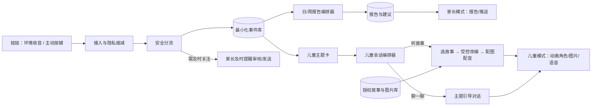
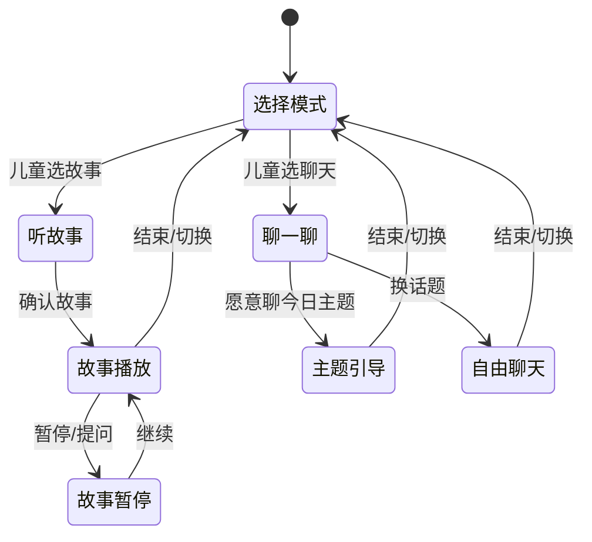

# 儿童陪伴产品 Agent 架构方案

版本：讨论稿 v0.1（2026-10-11）  
范围：5–12 岁儿童；一个 App 切换家长模式与儿童模式；娃娃负责收音、按键、简单反馈，平板上的动物角色负责讲故事和聊天。

## 1. 目标与边界

这套 Agent 系统完成四件事：

1. 将小朋友主动按键说的话，以及家长设定时段内环境音产生的**有限观察结果**，整理成当日、当周报告和可执行的家长建议。
2. 根据当日主题，从已获授权且经过编辑审核的故事库选故事；在允许改编的范围内，对故事做不超过 20% 的受控修改。
3. 为故事准备与段落对应的插图和语音，儿童端在动物角色讲述时同步展示图片。
4. 在儿童模式的同一个聊天入口询问“想听故事，还是想聊一聊？”；聊天主题可来自小朋友主动按键留下的问题。

**数据边界：**环境音只用于当次情绪线索和安全风险识别；长期仅保留最小化的情绪/风险摘要、时间范围、置信度与处理状态。环境原音和逐字转写不入库。主动按键录音可在内存中临时转写；沿用前述产品方案，经过脱敏的逐字内容只在当天供家长纠错，到家庭本地午夜清除；跨日仅保留必要的结构化事件摘要。儿童聊天会话也采用短期上下文，单独设置短期清理期限，不默认写入家长报告。以上保存期限应做成可配置策略，并在产品上线前完成适用地区的儿童隐私审查。

报告只陈述有证据支持的观察，不给孩子贴诊断或人格标签。环境音无法可靠确认说话者时，不应写成“孩子今天发生了某事”。发现疑似即时安全风险时走独立的及时提醒流程，不等晚上 19:00 的报告。

## 2. 总体结构

这里的“Agent”是职责清晰、受工具和数据权限约束的服务模块。业务编排器决定流程与状态转换；模型只能在各模块允许的范围内生成内容，不能自行读取整个数据库、直接给家长推送、直接发布故事或扩大数据保留范围。



系统有三条固定工作流：

| 工作流 | 触发 | 产物 | 对外可见前的关口 |
| --- | --- | --- | --- |
| 语音接入 | 环境收音窗口、儿童按键 | 最小化事件、必要的安全提醒 | 来源识别、脱敏、风险分级 |
| 报告与故事准备 | 家庭当地时间 19:00、周报日、家长纠错 | 日/周报告、家长建议、候选故事包 | 证据核对、内容安全、故事/图片授权与校验 |
| 儿童会话 | 儿童打开同一聊天入口 | 故事播放或主题聊天 | 每轮输入/输出安全检查、身份与模式权限 |

建议先采用一个后端服务内的显式状态机（或 LangGraph 固定流程），配合定时任务和任务队列；模型调用封装为可替换接口。若使用 LangGraph 持久化检查点，状态中只放事件 ID、主题码和内容版本 ID，不放原始音频、环境转写或完整儿童话语，因为检查点会保存图状态快照。[LangGraph 持久化说明](https://docs.langchain.com/oss/python/langgraph/persistence)

## 3. Agent 职责与权限

| 模块 | 读取 | 输出 | 禁止事项 |
| --- | --- | --- | --- |
| 接入与隐私缩减器 | 当前音频、设备/家庭时段配置 | 来源标记、脱敏事件、环境摘要 | 保存环境原音或逐字稿 |
| 安全分流器 | 当前片段的临时特征/临时转写、历史最小必要摘要 | 风险等级、证据类型、处理队列 | 单凭模糊环境声音确认施害者或给出医学结论 |
| 证据聚合器 | 本日/本周事件、家长纠错 | 带来源与不确定性的事实表 | 把同一事件在日报和周报中重复计数 |
| 报告 Agent | 事实表、年龄段、学校阶段、家长设置 | 家长可读报告草稿 | 编造孩子说过的话、引用已过期逐字稿 |
| 家长建议 Agent | 经核对的事实表、已审核建议库 | 今日/本周建议，附适用条件 | 输出惩罚、诊断或未经证实的严重指控 |
| 故事检索 Agent | 主题码、年龄段、情绪强度、库元数据 | 已授权故事候选及理由 | 搜索未经授权的全文并直接改编 |
| 故事改编 Agent | 选中的可改编原文、编辑规则、主题卡 | 版本化的改编稿与逐句差异 | 超过 20% 修改；写入真实姓名、学校、原话 |
| 插图规划 Agent | 通过审核的故事分镜、授权资产库 | 每段插图 ID 或生成任务 | 把儿童音频/逐字稿送给图像服务 |
| 讲述编排 Agent | 审核后的故事、插图、配音 | 可播放的故事包 | 播放未审核的图像或内容 |
| 儿童对话 Agent | 儿童主动选定的模式、最小主题卡、短期会话上下文 | 一轮回复、下一步意图 | 把家长报告直接念给儿童、泄露别的家庭资料 |

编排器只通过声明好的工具调用这些模块。所有写入、推送和发布由确定性服务检查权限与状态后执行，不能由大模型自由决定。

## 4. 语音到证据：两类来源分开处理

### 4.1 环境收音

家长配置的工作时段内，设备以短窗口采集；服务端做语音/非语音判断、情绪线索和安全风险识别，立刻丢弃音频和临时转写。可使用前一步调研的 MOSS-Audio-4B-Instruct 做音频情绪与事件线索，以及安全文本模型处理临时 ASR 文本，但这些模型只提供**线索**，儿童场景的阈值和误报要用真实测试集校准。保存记录形如：

```json
{
  "source": "ambient",
  "time_bucket": "2026-10-11T15:00+08:00/30m",
  "emotion_signal": "possible_distress",
  "safety_signal": "none",
  "confidence_band": "low",
  "speaker_attribution": "unknown",
  "retention_class": "minimal_summary"
}
```

环境音只能作为“该时段出现过可能的情绪/安全线索”的记录。没有清楚的主动表达或家长确认时，报告不得推断具体事件或对象。

### 4.2 主动按键

设备按键开始录音，给予可察觉的录音提示，松开或超时后结束。音频在短暂处理时转写、脱敏，并抽取一个或多个事件：孩子想说什么、主题、是否需要家长关注、来源为“儿童主动表达”、模型置信度。临时音频处理完成后删除；当日脱敏转写供家长纠错，跨日只留结构化事件。若家长纠错，当日报告和未播放的故事包应重新计算。

```json
{
  "source": "child_button",
  "event_id": "evt_...",
  "topic_codes": ["friendship_exclusion", "missing_family"],
  "child_self_report_summary": "提到同伴今天没有和自己玩，并表达想念家人",
  "time_bucket": "afternoon",
  "confidence_band": "medium",
  "guardian_corrected": false,
  "retention_class": "structured_event"
}
```

风险路由有三个出口：普通事件进入晚间报告；需要家长留意的事件可在家长设置的提醒策略下尽早提醒；疑似急迫风险进入人工复核/应急流程。提醒文字说明“不确定性”和来源，不把模型判断包装成事实。

## 5. 日报、周报与家长建议

### 5.1 日报

家庭当地 19:00 生成当日版本。证据聚合器先生成“事实表”，包含每个主题的来源事件 ID、时间桶、置信度、家长纠错和样本覆盖情况；报告 Agent 仅根据事实表写作。产物包括：

- **今日观察：**主动表达的事项与环境中的非归因线索分开显示。
- **可能需要关注：**以“孩子提到……”“记录显示可能……”表述，附不确定性。
- **今日建议：**从已审核建议库选 1–3 条具体行动，如“今晚先问孩子是否愿意讲讲那次相处”，避免替家长下结论。
- **故事主题：**只输出主题码和适龄条件，不将报告全文发给儿童端。
- **数据覆盖：**工作时段是否有设备在线、按键记录是否存在，防止把“没有录到”当成“没有发生”。

生成后走事实核对：每条陈述必须引用事件 ID；没有证据的句子删除；当日材料不足时输出“今天记录不足以判断具体情况”，仍可给通用陪伴建议。家长模式可查看、纠错、隐藏单条内容。推送通知用中性短句（例如“今日陪伴报告已生成”），具体敏感内容只在解锁后的家长模式中显示。

### 5.2 周报

周报从**已去重的结构化事件和日报事实表**聚合，不把七份日报再次作为新证据。输出主题出现趋势、孩子主动提及的事情、积极变化、需要持续关注但证据有限的点，以及本周 2–4 条引导建议。周报明确有效记录天数；不足时不计算趋势。周报内容和推送与日报一样支持家长纠错、版本更新。

### 5.3 报告数据合同

```json
{
  "report_id": "daily_...",
  "period": "2026-10-11",
  "version": 2,
  "coverage": {"device_online_minutes": 180, "button_event_count": 2},
  "observations": [
    {"text": "孩子主动提到同伴没有和自己玩", "source_event_ids": ["evt_..."], "certainty": "self_report"}
  ],
  "parent_suggestions": [
    {"action": "先听孩子描述具体经过，再一起想一个下次可以尝试的邀请方式", "basis_event_ids": ["evt_..."]}
  ],
  "story_topic_codes": ["friendship_invitation"],
  "status": "ready_for_parent_view"
}
```

## 6. 故事选择、20% 改编与插图

### 6.1 故事库是前置依赖

每个故事入库时要记录：`story_id`、原文版本、适龄范围、主题、篇幅、语言、可能的敏感元素、原图资产、授权来源、署名方式、是否允许商业使用、是否允许改编、是否允许生成衍生图、人工编辑审核状态。只有许可覆盖相应使用方式且状态为 `approved` 的条目才能进入线上检索。**“只改 20%”不是版权豁免；无改编授权的作品即使只改一个字，也不能作为可改编素材。**例如 CC BY 4.0 允许在遵守署名等条件下改编；带 ND 条款的内容不能按本方案分发改编版，带 NC 条款的内容不能默认用于商业产品。[Creative Commons BY 4.0](https://creativecommons.org/licenses/by/4.0/legalcode.en) · [Creative Commons FAQ](https://creativecommons.org/faq/index.html)

检索先用硬条件过滤：授权、年龄、长度、内容禁忌、可用语言、审核状态；再以主题贴合度、故事质量、近期重复次数和儿童偏好排序。`选故事`是推荐，不意味着强制播放。儿童可以选别的故事、跳过，或直接聊天。

### 6.2 可执行的 20% 上限

建议在编辑后台先把原故事拆成固定场景与句子，锁定角色关系、故事主线、结局和价值方向。运行时只开放少量“可替换句”或“可补充句”。自动检查同时满足：

1. **文本量：**新增、删除、替换所涉及的汉字数之和不超过原文汉字数的 20%；标点和格式变化另计，不用它们绕过限制。
2. **结构：**至少 80% 原句保持原意；场景顺序、主要冲突、结局与核心价值不改变。结构检查由规则加模型审核，模糊时退回原版。
3. **个性化边界：**只能映射到通用主题（例如“邀请同伴一起玩”）；不得代入孩子真实姓名、学校、家庭关系细节、原话或暗示娃娃在背后监听。
4. **授权和内容：**改编稿、配图方式仍满足原文与插图的许可证和署名要求，内容通过儿童适龄与安全审核。

20% 的编辑量定义应在内容团队试用后定版；短故事如果没有足够的可改空间，就直接播放原版或选择另一篇。系统保存原文版本、改编版本、差异、审核结果，以便复现家长看到的推荐与儿童听到的内容。

### 6.3 插图与讲述包

先匹配授权明确、经过人工审核的图库资产；缺少画面时，插图规划 Agent 输出**不含儿童个人信息**的分镜描述、角色外观规范和画面比例，生成候选插图。新生成图片要做年龄适宜、安全、角色一致性和版权来源记录，再进入人工编辑抽检/审核。为了保证每天 19:00 后可稳定讲述，线上优先用事先审核的图片池；当晚新生成且尚未审核的图片不直接给儿童展示，失败时回退到原图或通用已审核图片。

讲述编排 Agent 将故事按场景切分，生成或调用配音、字幕与同步清单：

```json
{
  "story_id": "story_...",
  "story_version": 3,
  "scenes": [
    {"scene_id": "s1", "text": "……", "image_asset_id": "img_...", "audio_asset_id": "aud_...", "start_ms": 0, "end_ms": 12000}
  ],
  "attribution": [{"title": "……", "creator": "……", "license": "CC BY 4.0"}],
  "review_status": "approved"
}
```

儿童端预载下一张图，按音频段落切换插图和动物表情，可暂停、继续、跳过、返回聊天。故事版本一经播放就保持一致；家长之后纠错只更新尚未播放或下次播放的版本。

## 7. 一个入口：听故事 / 聊一聊

儿童打开 App 的动物角色聊天页后，动物角色用语音和两个大按钮询问：“你想听故事，还是想聊一聊？”语音回答不明确时只追问一次，并允许孩子直接点按钮。家长模式与儿童模式在同一个 App 中切换；报告、设置和录音管理仅在家长鉴权后可见。



### 听故事

儿童先看到 1–3 个可选故事卡，第一项可以是今日主题推荐，但可以拒绝。角色开场、分场景讲述、同步显示插图；中途提问走短对话后回到原场景。安全检查对临时提问和回复逐轮执行。故事播放不把家长报告或原始录音传给儿童端。

### 聊一聊

聊天 Agent 只得到脱敏的“主题卡”，例如：`friendship_exclusion / 同伴相处 / 建议用开放式提问 / 来源：儿童主动按键 / 当天有效`。可以说“想聊聊和朋友一起玩的事吗？也可以聊别的。”不能说“我知道你今天被某某不理了”，更不能复述旁听到的对话。孩子选择继续后，采用倾听、澄清、给选择的短轮次引导；不代替家长、老师或专业人员作判断。孩子主动表达风险时，优先执行安全对话规则和家长提醒策略。

儿童可以随时说“不要聊这个”“换个故事”“结束”。对话上下文仅服务本次会话；若要把聊天中的新内容纳入家长报告，须作为一项明确、可见的产品设置和独立事件处理，不能悄悄混入原先的按键录入范围。

## 8. 编排时序与回退

| 时间/事件 | 服务动作 | 失败时的处理 |
| --- | --- | --- |
| 工作时段 | 设备上传片段；缩减为环境摘要或按键事件 | 网络暂断时仅短时加密排队并按容量/期限丢弃；不可无限缓存原音 |
| 任意时刻风险触发 | 安全分流、必要时及时通知家长 | 高风险但模型不确定时进入复核，不编造确定结论 |
| 每日 19:00 | 冻结当日快照、生成日报/建议、准备候选故事 | 报告证据不足则明确说明；故事准备失败用已审核原版 |
| 周报日 | 聚合去重事件、生成趋势与建议 | 有效天数不足则展示记录概况，不输出趋势 |
| 家长纠错 | 更新证据版本、重算报告和未播放故事 | 已播放故事保留原版本与审计记录 |
| 儿童进入聊天页 | 单入口选择模式、执行故事或聊天 | 图像不可用用审核过的备图；配音不可用提示稍后重试 |

每日生成时间需要明确：如果家长设置的收音结束时间晚于 19:00，则 19:00 先生成“截至目前”的报告，收音结束后补齐并标记版本更新；也可允许家长设置报告时间。周报使用家庭时区，明确周起止日。

## 9. 上线所需的审核与指标

**内容审核：**故事与图库的授权、适龄、敏感主题和署名由编辑入库时审核；运行时改编要经过差异上限和内容审核。新生成插图先入候选库，经审核后才可成为可播放资产。高风险建议模板由儿童心理/教育顾问审核，但产品输出依然是日常陪伴建议，不是临床判断。

**权限审计：**每次模型调用记录所用模型版本、输入数据类别、事件/资产 ID、输出版本、审核结果、删除时间；日志不得包含原始音频和完整儿童逐字稿。第三方 ASR、LLM、TTS、图像服务的训练使用、保存期限、删除能力和数据地区要逐一核验。

**试运行指标：**

- 环境音误报与漏报、说话者归因错误率；按键事件主题抽取准确率。
- 日/周报告的每句有据率、家长纠错率、建议有用率、敏感推送误发率。
- 故事推荐被选择率、孩子中途退出率、重复故事比例；改编差异越界率应为 0。
- 图片与配音审核通过率、图片和语音同步偏差、首句播放等待时间。
- 儿童会话的安全升级正确率、无证据复述率、孩子主动结束是否被尊重。

## 10. 推荐实施顺序

1. **数据合同与权限：**先定义环境摘要、主动事件、主题卡、报告、故事包的数据结构和删除期限，做家长/儿童模式鉴权。
2. **报告闭环：**按键事件 → 日报/周报事实表 → 家长建议 → 纠错/版本更新；环境音暂只补充非归因的低权重线索。
3. **故事闭环：**建立一小批已授权、已审核的故事和插图库；先用确定性主题检索与编辑好的可替换句验证 20% 改编规则。
4. **儿童单入口：**完成模式选择、讲故事图片同步、主题引导聊天、随时切换/退出。
5. **逐步增加生成：**在审核和回退机制稳定后加入受控故事改编、候选插图生成、多样化配音。每一步用真实家庭试点数据校准，而不是让一个通用 Agent 一次完成全部决策。

这份架构可作为现有[系统架构方案](儿童陪伴娃娃软硬件系统架构方案.md)和[环境音模型调研](环境音频情绪与安全风险模型调研.md)之上的 Agent 设计层；具体接口和数据库表可在下一轮按这份数据合同展开。
