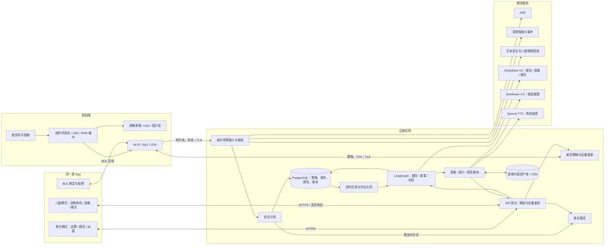

# 儿童陪伴产品整体技术架构

版本：v0.1｜2026-10-11  
定位：5–12 岁儿童陪伴产品；娃娃负责感知、按键表达和简单表情/声音；**同一款 App** 在家长手机与儿童平板上切换家长模式、儿童模式。本文整合[产品需求文档](儿童陪伴娃娃产品需求文档.md)、[软硬件方案](儿童陪伴娃娃软硬件系统架构方案.md)、[Agent 方案](儿童陪伴产品Agent架构方案.md)和[环境音模型调研](环境音频情绪与安全风险模型调研.md)。

## 1. 架构决策

1. **设备独立联网。** 娃娃经 Wi‑Fi/TLS 向云端上传受限的短音频片段；BLE 只用于首次绑定、配网和近场控制。产品不依赖 iPhone 或 Mac 常开做音频中继。
2. **一个 App，两套权限。** 同一 iOS/iPadOS App 有家长模式和儿童模式。模式切换由服务端权限与家长验证约束，而非只换界面。儿童平板主要承载动物角色讲故事、配图和聊天。
3. **音频处理与 Agent 分层。** 音频在临时处理区完成 ASR、情绪/安全线索提取和脱敏；LangGraph 只读取最小化事件、主题卡与内容 ID，负责报告、故事准备和儿童对话的固定流程。
4. **安全提醒独立于晚间报告。** 疑似急迫风险进入单独的高优先级路由；晚间 19:00 报告负责日常总结，不承诺实时监护。
5. **故事资产先审核后播放。** 故事和图片库记录版权、适龄和审核状态。运行时故事改动不超过约定的 20%；新生成图片须通过审核，来不及审核则使用已批准资产。
6. **环境音仅存最小摘要。** 环境原音及逐字转写不持久化；只存情绪/风险线索、来源与不确定性。按键主动表达另走短期脱敏转写及结构化事件规则。

## 2. 端到端系统图



**Mac 的位置：**当前实验工程仍可用 Mac 作为本地网关与播放终端，验证 USB 刷机和端到端链路；产品版把这部分迁到云端。当前 M5StickC Plus 1.1 可验证按键、短录音、Wi‑Fi、表情、上报，尚不能据此认定全天续航、远场儿童识别、量产 BLE/OTA 或扬声器播放可行。

## 3. 四层职责

| 层 | 组件 | 负责的事情 | 明确边界 |
| --- | --- | --- | --- |
| 娃娃硬件与固件 | 麦克风、按键、屏幕、LED、蜂鸣器、RTC、电源、Wi‑Fi/BLE | 执行家长时段策略、短时录音/VAD、上传、可见的收音/静音反馈 | 不在设备持久化原始音频；不在现有 ESP32 板上运行大模型 |
| App | 家长模式、儿童模式、BLE 配网、推送接收 | 设置年龄/学段/时段；看日周报与建议；儿童故事和聊天 | 儿童凭证无法查询家长报告；App 不担当全天音频中继 |
| 应用后端 | 身份权限、设备管理、音频接入、事件/报告/内容 API、通知 | 审核执行、版本管理、删除、幂等、任务调度 | 关键授权与推送由确定性服务决定，不交给 LLM |
| 模型与 Agent | 临时 ASR/音频分析、安全分类、LangGraph、生成模型 | 从最小证据生成报告、建议、故事、回复和候选插图 | 模型输出都要经过来源、版权、适龄和安全校验 |

### 3.1 硬件和固件

**验证板：**M5StickC Plus 1.1（ESP32-PICO-D4，4 MB Flash、520 KB SRAM、SPM1423 麦克风、135×240 LCD、两个按键、LED、无源蜂鸣器、120 mAh 电池）。它适合验证短时采集与交互；无源蜂鸣器可做提示音，想在娃娃上自然地“喵喵”需增设可播放音频的扬声器链路。[M5Stack 官方规格](https://docs.m5stack.com/en/core/StickC-Plus)

**量产硬件待选：**有足够 RAM/PSRAM 和 OTA 双分区空间的 Wi‑Fi/BLE 主控、更适合的麦克风与声学腔体、扬声器/功放、较大电池、实体静音开关、与采集状态联动的明显指示。远场多人环境是否需要双麦，须先测 1–3 米中文儿童语音与噪声场景；双麦不能自动证明目标孩子是谁。

**固件状态机：**未绑定 → 已绑定待授权 → 时段外 → 感知中 → 按键表达 → 上传中 → 成功/失败；实体静音、断网、策略过期、时钟失效、低电量均有独立状态。收音窗口由服务端签发 `timezone + windows + valid_until + policy_version`，设备回报已执行版本。家长端分别显示“设置已保存”和“设备已执行”。

### 3.2 App

| 家长模式 | 儿童模式 |
| --- | --- |
| 家庭与孩子档案：年龄、幼儿园/年级、设备归属 | 一个动物角色聊天入口：选“听故事”或“聊一聊” |
| 收音时段、暂停、实体设备状态和告知管理 | 故事卡选择、插图随讲述切换、暂停/跳过/返回 |
| 日报/周报、今日/本周建议、提醒偏好 | 基于最小主题卡的引导聊天，也可换话题 |
| 当日按键脱敏转写纠错、删除、权限管理 | 明显的平板麦克风启用提示和随时退出 |

通知只显示中性文案；点开后再做家长鉴权。儿童模式仅取 `topic_card` 和已审核的故事包，不下发完整家长报告。

### 3.3 云端应用

首版采用**模块化单体 API + 独立异步工作进程**。建议 Python/FastAPI 承载 API 与服务编排；PostgreSQL 保存结构化业务数据；Redis/任务队列处理报告、配图、配音等作业；对象存储/CDN 只放已审核的故事、图片和配音资产。敏感原始音频不得成为普通队列消息、数据库字段、对象存储对象或可持久化的日志内容。

边界模块：`Identity`、`Device/Policy`、`EphemeralAudio`、`Safety`、`Evidence`、`Reports`、`StoryCatalog`、`ChildSession`、`Notifications`、`Governance`。每个模块有固定输入输出；模型服务通过接口隔离，便于比较云 API 与自部署模型。

### 3.4 模型服务

- **临时语音识别：**ASR 将按键语音转为临时文本；环境语音若要做内容安全判断也只作临时转写。
- **环境音线索：**以此前调研的 MOSS-Audio-4B-Instruct 作为候选；其情绪与声音事件判断仅是待校准线索。
- **文本安全线索：**Qwen3Guard-Gen-4B 可作为内容审核候选，叠加儿童情境风险规则和复核；它不是已验证的儿童危险检测器。
- **大语言模型：DeepSeek V4。** 报告写作、受控故事改编和儿童聊天共用模型网关，但使用不同的提示词、工具白名单、结构化输出协议和安全检查。接入时以官方当前支持的模型 ID（例如 `deepseek-v4-pro`）为准，并记录实际返回的模型版本，避免别名路由变化影响复现。[DeepSeek 官方 API 文档](https://api-docs.deepseek.com/guides/codex) · [当前模型清单](https://api-docs.deepseek.com/quick_start/pricing/)
- **图像模型：Seedream 4.5。** 只接收脱敏的故事分镜、角色外观规范和画面要求，生成候选插图；未审核图片不直接在儿童端播放。火山引擎文档列出的模型 ID 为 `doubao-seedream-4-5-251128`。[火山引擎 Seedream 模型文档](https://docs.volcengine.com/docs/ark/seedream-4-0-5-0?lang=zh)
- **TTS 首选：Qwen3-TTS-12Hz-1.7B-CustomVoice。** 支持中文和流式生成，可固定一个经内容团队选定的角色音色，故事采用提前分段合成，聊天采用流式合成；不使用小朋友声音做克隆。需要独有动物角色声音时，可另评估 VoiceDesign 生成经审核的参考音色，再按官方方案复用。该模型卡列出 Apache 2.0 许可。[Qwen3-TTS 官方仓库](https://github.com/QwenLM/Qwen3-TTS) · [CustomVoice 模型卡](https://huggingface.co/Qwen/Qwen3-TTS-12Hz-1.7B-CustomVoice)

这些模型的实际准确度、价格、延迟和数据保留条件都需要试点验证，不能以通用模型基准代替儿童场景验收。图中的“推送”是后端业务功能，不作为外部模型或应用服务选型项。

## 4. LangGraph 工作流设计

LangGraph 的优势是把规则步骤、模型步骤、条件分支和必要的人工审核放在同一固定图中；其检查点会保存图状态，必须限制状态字段。[LangGraph 官方总览](https://docs.langchain.com/oss/python/langgraph/overview) · [持久化机制](https://docs.langchain.com/oss/python/langgraph/persistence)

### Graph A：日报/周报

```text
触发（日程/家长纠错）
 → 读取已授权的结构化事件 ID
 → 聚合覆盖度、去重、按来源形成事实表
 → 风险/不确定性标记
 → 报告草稿 Agent
 → 家长建议 Agent（从审核建议库选择或受控改写）
 → 逐句核对证据 ID、用语与敏感信息
 → 版本化发布 → 中性推送
```

日报默认家庭当地 19:00 生成；如家长收音时段跨过 19:00，标记“截至当前”并在窗口结束后更新。周报从去重事件和已核对事实聚合，写明有效记录天数；没有足够数据时不输出“趋势”。高风险提醒另走 Safety 流程，不等待 Graph A。

### Graph B：故事包准备

```text
报告中的通用主题码
 → 授权/适龄/审核硬过滤
 → 候选故事排序
 → 受控改编（仅有改编权的故事）
 → 自动 diff ≤20% + 剧情/适龄/隐私校验
 → 分镜与已审图片匹配
 → 可选生成候选插图并进入审核库
 → TTS 分段 + 图片时间轴
 → 发布 story_package_id
```

新生成插图未审核时，故事包采用批准过的原图或通用图片。故事改编不嵌入真实姓名、学校、原话或“我听见你今天……”之类暗示。20% 是内容修改上限，不替代原作品的改编授权。内容审核可用 LangGraph 中断与恢复，但不能让面向儿童的播放请求实时等待编辑审批。[LangGraph 中断机制](https://docs.langchain.com/oss/python/langgraph/interrupts)

### Graph C：儿童会话

```text
进入同一聊天页
 → 模式选择（故事 / 聊天）
   ├─ 故事：推荐卡 → 儿童选择 → 已审故事包 → 分段播放/配图/短问答
   └─ 聊天：儿童主动同意主题 → 读取当日最小主题卡 → 引导对话
 → 每轮输入风险检查 → 回复生成 → 输出检查 → TTS/字幕
 → 结束、切换、短期清理
```

此图只处理当前会话所需的短期上下文。儿童说“不要聊这个”应立即退出主题；如涉及风险，进入安全对话与家长提醒策略。儿童会话的完整逐字内容默认不被日/周报读取。

**图状态约束：**仅保存 `family_id` 的受控引用、`event_ids`、`topic_codes`、`report_version`、`story_package_id`、审核状态和作业状态。环境原音、环境逐字稿、按键原音、完整儿童会话和供应商原始响应不写入持久检查点、追踪系统或任务队列。若儿童聊天需要跨轮临时上下文，使用明确 TTL 的短期会话存储，并测试删除与日志链路。

## 5. 关键数据流与保存边界

| 数据 | 从哪里来 | 处理与存放 | 下游可见范围 |
| --- | --- | --- | --- |
| 环境短片段 | 家长许可时段内的娃娃麦克风 | 临时缓冲处理，处理完即删；不做持久音频库 | 仅分析服务可见当前片段 |
| 环境摘要 | 情绪/风险模型与规则 | 时间桶、线索类别、置信度、归因状态；最小化存库 | 报告 Agent 可读，不可改写成确定的孩子经历 |
| 按键短片段 | 儿童主动按键 | 临时 ASR，音频删除 | 仅接入/分析服务 |
| 当日脱敏转写 | 按键片段 | 当天供家长纠错，按家庭当地午夜清理 | 家长鉴权后可见，不给儿童故事/图像模型 |
| 结构化主动事件 | 脱敏转写抽取 | 主题、简短自述摘要、来源、置信度、纠错 | 报告读取；儿童端只收最小主题卡 |
| 日/周报告 | Graph A | 版本化，含证据引用和不确定性 | 仅家长模式 |
| 故事/插图/配音 | 审核库 + Graph B | 版本化资产与许可署名，CDN 分发 | 儿童模式可播放已审核版本 |
| 聊天上下文 | 儿童模式当前会话 | 短期 TTL，明确删除 | 仅本次会话；默认不进家长报告 |

即使自有系统不保存原音，云端 ASR、音频模型、TTS 和图像供应商仍可能有自己的日志或保留机制；上线前必须核查实际配置与合同。学校、幼儿园等多人场所不能仅凭家长时段设置就启用环境录音，应单独完成场所告知、授权和适用法规评估。此产品不应宣传为能可靠识别儿童情绪、诊断心理问题或提供实时安全监护。

## 6. 关键接口与事件

| 接口/事件 | 调用方 → 服务端 | 结果 |
| --- | --- | --- |
| `POST /device/claim` | 家长模式 + BLE 认领码 | 家庭、设备绑定；设备独立身份凭证 |
| `PUT /capture-policy` | 家长模式 | 新策略版本；设备拉取并 ACK 后显示已执行 |
| `POST /device/segments` | 娃娃 | 幂等接收、临时处理作业 ID；上传源为 `ambient`/`button` |
| `POST /device/telemetry` | 娃娃 | 电量、固件、网络、静音与策略版本 |
| `ReportReady` | 定时作业 → 通知服务 | 家长收到中性推送，敏感详情在 App 内查看 |
| `GET /reports` / `POST /events/{id}/feedback` | 家长模式 | 查看、纠错、触发版本重算 |
| `GET /stories/recommendations` | 儿童模式 | 已审故事候选，不含家长报告 |
| `POST /child/sessions` / `POST /child/sessions/{id}/turns` | 儿童模式 | 单入口模式选择、故事/聊天回应 |
| `GET /story-packages/{id}` | 儿童模式 | 场景文本、插图、配音时间轴与署名 |

所有设备上传需带设备身份、递增或随机片段 ID、策略版本与时间；后端验证时段、长度、速率、归属和重复上传。所有 App API 按模式和孩子档案检查权限，不能信任前端传来的 `mode` 字符串。语音/图像供应商密钥只保存在服务端。

## 7. 部署与运行

```text
App / 娃娃
   ↓ TLS
API 与设备入口（鉴权、限速、策略）
   ├─ 临时音频处理进程 / 受控模型网关
   ├─ PostgreSQL：账号、策略、事件、报告、内容台账
   ├─ 异步作业：日报、周报、故事包、配音、通知
   ├─ LangGraph 工作者：只接最小化数据引用
   ├─ 审核后台：故事许可、插图、例外报告与风险处置
   └─ 对象存储 + CDN：审核后的故事图音资产
```

首版可部署为一套模块化服务和数类工作进程，不需要从第一天拆成许多微服务。模型网关提供 ASR、音频理解、文本安全、DeepSeek V4、Seedream 4.5、Qwen3-TTS 的统一适配，便于按供应商和部署方式切换。每条链路记录 `request_id`、数据类别、模型版本、内容版本与结果状态；监控错误率、延迟和队列积压，同时屏蔽音频、逐字稿和敏感提示词。作业重试采用幂等键，避免重复报告、重复推送和重复扣费。

## 8. 从当前验证板到产品试点

| 阶段 | 需要打通的闭环 | 放行条件 |
| --- | --- | --- |
| 1. 当前板实验 | 按键 → Wi‑Fi → 临时 ASR → 结构化事件 → 家长日报 → 平板故事/聊天 | 链路可复现，音频删除可验证，设备成功/失败有反馈 |
| 2. 环境音受控实验 | 家庭内短窗口 → MOSS/安全模型 → 仅最小摘要 → 家长不确定性展示 | 测得误报/漏报与说话者归因错误；达到预设阈值才扩围 |
| 3. 内容与 Agent | LangGraph 三图、审核故事库、20% diff、配图配音时间轴 | 报告逐句有据；越界改编为零；未审图不会被播放 |
| 4. 家庭试点硬件 | 改良麦克风、扬声器、实体静音、续航、签名 OTA 与回滚 | 长时段功耗、温升、静音有效性、网络恢复、固件回滚实测通过 |
| 5. 多家庭产品化 | 隔离、权限、删除、供应商保留核查、运营审核 | 家长/儿童模式越权测试与删除验收通过，敏感风险处置有人负责 |

**当前最值得先做的工程切片：**用现有 M5StickC Plus 完成一次按键表达的端到端链路，同时用 10–20 篇授权故事、现成审核图片和少量建议模板完成 Graph A/B/C 的最小闭环。这样可以先验证“证据 → 家长建议 → 儿童故事/聊天”是否真正有价值，再决定量产硬件与模型规模。
