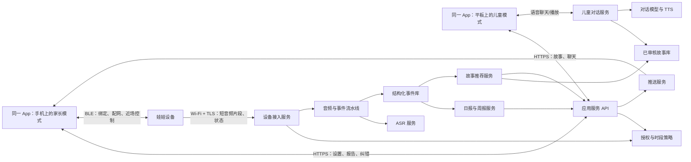
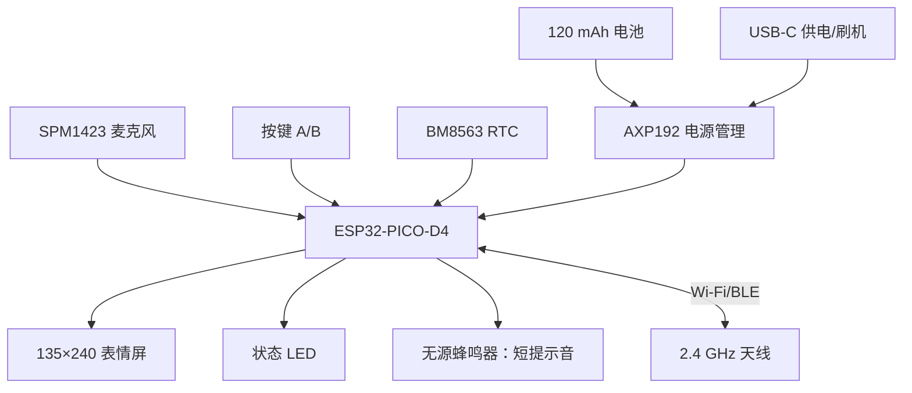
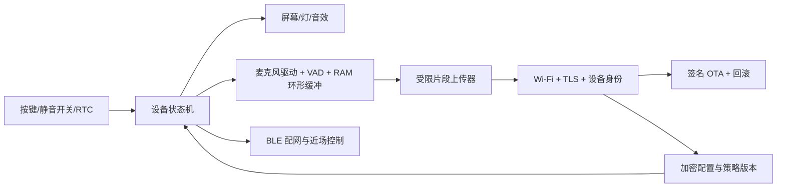

# 儿童陪伴娃娃软硬件系统架构方案

版本：架构讨论稿 0.1｜2026 年 10 月 10 日  
适用范围：5–12 岁儿童；娃娃采集与状态反馈；同一款 App 安装在家长手机或儿童平板上，通过家长模式与儿童模式切换功能。与[产品需求文档](儿童陪伴娃娃产品需求文档.md)、[开放资料借鉴清单](儿童陪伴产品开放资料借鉴清单.md)配套阅读。

## 1. 架构结论与运行边界

**设备通过 Wi‑Fi 独立连接服务端；BLE 负责首次绑定、近场配置和控制；一款 App 通过家长模式和儿童模式访问各自功能。** 同一安装包可运行在 iPhone 和 iPad，家庭账号同步设备、设置和内容。娃娃不等待 App 在 iPhone 后台运行才能收音或上传。Apple 的 Core Bluetooth 后台执行有时长与系统调度限制，不适合担当全天音频中继。[Apple Core Bluetooth 后台说明](https://developer.apple.com/library/archive/documentation/NetworkingInternetWeb/Conceptual/CoreBluetooth_concepts/CoreBluetoothBackgroundProcessingForIOSApps/PerformingTasksWhileYourAppIsInTheBackground.html)

这里把“**不存音频**”定义为：设备只用易失性 RAM 做短暂采集缓冲；服务端在转写完成后删除临时音频，不写入持久化音频库、应用日志或备份。文本事件与报告仍是儿童个人信息，必须单独设置保留和删除规则。云端 ASR 等供应商的处理与保留行为需按实际合同及配置核对，不能因自有系统不保存就宣称端到端零留存。

**环境感知与主动留言是两个数据等级。** 时段内允许环境感知，只产生受限的短片段和低确定性的观察；孩子按键倾诉可标记为“主动表达”，但也不能自动证明每个词都由孩子本人说出。说话人识别必须经过单独评测。学校、幼儿园等多人场所另设场所授权与告知门槛；家长设置时间本身不能代替在场人员的处理依据。[儿童个人信息网络保护规定](https://www.cac.gov.cn/2019-08/23/c_1124913903.htm) · [个人信息保护法](https://www.cac.gov.cn/2021-08/20/c_1631050028355286.htm)

## 2. 端到端连接架构

### 链路分工

| 链路 | 用途 | 主原则 |
| --- | --- | --- |
| App 家长模式 ↔ 娃娃 BLE | 首次认领、Wi‑Fi 配置、近场暂停、设备状态、故障恢复 | BLE 配对与业务上的“绑定家庭”是两件事；设备必须向服务端证明所有权。BLE 不传日常原始音频。 |
| 娃娃 ↔ 云端 Wi‑Fi | 拉取签名策略、状态上报、时段内受限片段与按键留言、固件更新 | 采用 TLS 和设备身份认证；短暂断网不转成无提示的本地录音。 |
| App 家长模式 ↔ 云端 | 管理孩子档案、授权、时段、报告、反馈、删除与设备 | 服务端保留唯一策略版本；设置写入后显示设备是否已确认执行。 |
| App 儿童模式 ↔ 云端 | 展示动物角色、读/播故事、儿童语音聊天 | 只取本次互动必需的故事和会话信息；家长报告不下发给儿童模式。 |
| 云端 ↔ ASR/模型/TTS 供应商 | 临时转写、事件提取、对话与合成声音 | 供应商密钥仅在服务端；按用途发送最少数据；记录供应商与模型版本。 |

Mac 在目前的实验工程中是**本地网关和播放终端**，可用于研发验证；产品链路不依赖 Mac 常开。现有原型代码与测试范围见[实验工程说明](M5StickCPlusVoice/README.md)。

### 建议的最小接口契约

以下是待实现的接口边界，并非当前实验网关已具备的 API。设备接口和 App 接口应分开鉴权；同一 App 在两种模式下也使用不同权限范围，服务端必须检查设备是否属于该家庭及该孩子档案。

| 调用方 | 接口/消息 | 关键入参与回执 |
| --- | --- | --- |
| App 家长模式 | `POST /families/{id}/devices/claim` | 一次性认领码、设备证明；返回绑定结果，不在 BLE 广播中放孩子资料。 |
| App 家长模式 | `PUT /children/{id}/capture-policy` | 时区、周时段、两种收音授权、场所限制；返回 `policy_version` 和生效状态。 |
| 娃娃 | `GET /device/policy` / `POST /device/policy-ack` | 拉取有限期策略、上报已执行版本和时钟状态。 |
| 娃娃 | `POST /device/segments` | `segment_id` 幂等、来源 `button/ambient`、时间、策略版本、短音频；回执只表示服务端已收到。 |
| 娃娃 | `POST /device/telemetry` | 固件/硬件版本、电量、Wi‑Fi、静音状态、错误码；不包含音频或转写。 |
| App 家长模式 | `GET /reports` / `POST /events/{id}/feedback` | 查看日/周报、纠错和删除；服务端保留修订版本。 |
| App 儿童模式 | `GET /stories/recommendations` / `POST /child/chat-turn` | 只返回可播放故事和本次会话答复；儿童模式凭证无权读取家长报告。 |

设备上传携带短期凭证和递增/随机 `segment_id`，服务端限制片段时长、每日数量与重复请求。事件处理、报告生成采用异步作业；App 用通知或轮询获得结果，不把耗时 ASR 放在设备 HTTP 请求里等待。

## 3. 娃娃硬件架构

### 3.1 当前验证板

M5StickC Plus 1.1 的官方规格为 ESP32-PICO-D4、4 MB Flash、520 KB SRAM、2.4 GHz Wi‑Fi、SPM1423 麦克风、135×240 LCD、两个按键、LED、无源蜂鸣器、RTC、PMU 和 120 mAh 电池。[M5Stack 官方规格](https://docs.m5stack.com/en/core/StickC-Plus) 目前板上固件已验证编译、刷入及启动；按键 5 秒录音、Wi‑Fi 上传和 Mac 网关模拟往返已做初步验证。BLE 真机配对、iOS 播放、云端实际调用以及连续时段收音尚未完成端到端验证。[实验工程说明](M5StickCPlusVoice/README.md)

当前板**适合验证**配网、按键倾诉、屏幕表情、短时段环境感知、云端事件与报告闭环；不应预设其可支撑整天持续收音、稳定远场辨认儿童声音或自然动物叫声。无源蜂鸣器适合提示音，想播放“喵喵”录音需增加音频 DAC/I2S 功放与扬声器，或在平板端播放。

### 3.2 产品版建议硬件模块

| 模块 | 建议架构 | 为什么需要 |
| --- | --- | --- |
| 主控与存储 | 选择具备 Wi‑Fi、BLE、足够 RAM/PSRAM 和双固件分区空间的 MCU 模组；ESP32-S3 可作为候选，容量由实测固件和资源决定。 | 为 VAD、TLS、屏幕、音效和安全 OTA 留余量；不把当前 4 MB 板直接当量产规格。 |
| 麦克风 | 先以一只数字麦克风验证近讲和环境声；若目标包括多人/远场，评估双麦及声学腔体。 | 双麦可帮助降噪和方位估计，但不保证识别目标儿童。 |
| 扬声器链路 | I2S/DAC → 功放 → 小扬声器，控制最大音量与启动音量。 | 娃娃能发出自然动物叫声；完整故事与聊天仍在平板端。 |
| 实体静音 | 儿童和家长可触及的物理开关，硬件上切断麦克风供电或数据通路；指示灯与真实麦克风使能状态联动。 | 即使固件出错，也能直观停止采集；实际电路需验证断电、回灌和故障状态。 |
| 状态反馈 | 常亮/常态可见的收音指示、屏幕表情、短提示音；低电与断网状态可区分。 | 用户与旁人能看出正在感知、暂停、留言或失败。儿童平板使用自身麦克风时，App 也须提供清楚的录音提示。[Apple 审核指南 2.5.14](https://developer.apple.com/app-store/review/guidelines/) |
| 电源 | 更大容量可充电电池、保护与充电电路、低电策略、电量估算和温升测试。 | 120 mAh 是验证板配置，不足以推断工作时段的续航。 |
| 安全与维修 | 每台设备独立身份、受保护密钥、签名固件、可回滚 OTA、USB 故障恢复；量产结构避免可拆小件。 | 支撑远程维护和设备丢失、失窃后的访问控制。[ESP-IDF OTA 回滚](https://docs.espressif.com/projects/esp-idf/en/stable/esp32/api-reference/system/ota.html) · [安全总览](https://docs.espressif.com/projects/esp-idf/en/latest/esp32/security/security.html) |

当前硬件评估的必要实测：安静/电视/多人/户外噪声下的语音检出率和误触发率，1–3 米距离的中文儿童语音 ASR 质量；Wi‑Fi 与 BLE 并存；连续工作时长、上传量、温升；麦克风静音的物理有效性；掉电与断网恢复。测试使用获授权、合成或成年人模拟语料优先。

## 4. 设备固件架构

**状态机**：未绑定 → 待授权/待时钟同步 → 时段外休息 → 时段内感知 → 按键倾诉 → 上传中 → 已收到/失败 → 暂停/静音/离线/低电。任何状态变更都同步更新屏幕和 LED；物理静音优先级最高。时间无效、策略过期、授权撤回、未获场所许可、存储/网络异常等情况默认不进入环境感知。

**时段策略**：家长在服务端设置 `timezone + weekday + start/end + valid_until + mode + policy_version`。设备联网后拉取策略并回传 `applied_version`；家长 App 显示“已保存/设备已执行”两个状态。离线时只运行尚未过期、已确认的策略，超期后自动停止环境感知。按键倾诉是否可在时段外启用需家长单独授权；实体静音始终有效。RTC 用于本地判断，联网时校时并检查漂移。

**音频路径**：麦克风只在获准时段或获准的按键操作中启用 → 本地 VAD 与短 RAM 缓冲 → 给片段打 `source=ambient/button`、时间、设备 ID、策略版本、片段序号 → 加密上传 → 收到服务端确认后擦除缓冲。环境片段需设置每段最大长度、最短间隔、每小时和每天上限；无语音不上传。服务端确认的是“收到片段”，不能在转写前显示“理解成功”。上传失败且坚持不持久保存音频时，设备清除片段并显示未送达；不能承诺孩子的留言稍后一定会出现在报告中。

**版本更新**：实验期仍可 USB 刷机；进入家庭试用前设计固件版本上报、签名镜像、双分区 OTA、启动自检和自动回滚。ESP-IDF 文档支持 OTA 回滚；具体安全启动/闪存加密配置应在选定 MCU 修订版后确认，且与 USB 恢复流程一同测试。[ESP-IDF OTA](https://docs.espressif.com/projects/esp-idf/en/stable/esp32/api-reference/system/ota.html)

## 5. 软件架构

### 5.1 App

**只有一款 App、一套安装包和共享代码。** 家长可在手机使用家长模式，孩子可在平板使用儿童模式；同一设备也允许切换。家长登录后为儿童设备选择孩子档案并开启儿童模式。切回家长模式要经家长验证，并由服务端授予家长权限；仅切换页面或知道家庭账号不应取得报告、设置、导出、删除或购买权限。儿童模式使用限权会话，且设备本地缓存不保存可从儿童模式读取的家长报告。家庭可关联多位孩子与多台设备，每个音频事件只有在归属明确时才进入相应孩子档案。[Apple Kids Category 家长门控要求](https://developer.apple.com/app-store/review/guidelines/)

| 同一 App 内的模式 | 页面与模块 | 与云端的关系 |
| --- | --- | --- |
| 家长模式 | 登录与家庭、孩子年龄/学段、设备绑定、收音时段与暂停、授权、日/周报、提醒、纠错、删除、设备健康。 | 设置由服务端签发策略；查看“最后同步时间/执行版本”；报告纠错触发后续汇总更新。 |
| 儿童模式（优先 iPad 展示） | 动物角色、今日故事、播放与跳过、故事后聊天、主动聊天、求助引导。 | 只拿经过审核的故事和受限会话上下文；聊天使用当前手机或平板的麦克风和扬声器。 |
| 家长模式内的近场控制 | BLE 扫描、PIN/设备证明、Wi‑Fi 配置、实体设备确认、解绑/恢复。 | BLE 凭证只用于认领和配置；日常家长操作通过云端下发。 |

模式切换的界面建议始终可见，但儿童点击“切换到家长模式”后必须完成家长验证；家长可直接进入儿童模式。儿童模式在 iPhone 上也能用，平板只提供更适合讲故事的布局。通知点击后仍按当前权限检查，不因 App 同装在一台设备上绕过家长验证。

### 5.2 后端

首版建议使用**模块化单体服务 + 异步作业队列**，把接口、设备接入、策略、音频处理、内容和报告逻辑分模块，避免过早拆成多个独立服务。核心模块如下：

1. **身份与家庭**：家长登录、儿童档案、设备归属、权限和家长门控结果。
2. **设备接入与策略**：注册/认领、设备凭证、时段策略、同步 ACK、在线状态、配置和 OTA 清单。
3. **音频接入**：限长、限速、鉴权、幂等、临时内存或受控短暂缓存；把原始音频传给 ASR 后删除。缓存、崩溃转储、链路日志和备份都不得意外保留音频。
4. **转写与事件**：ASR → 文本清理 → 必要时说话人分段 → 主题/事件提取 → 证据与置信度标注 → 第三人信息最小化。说话人分段不等于身份确认。[ESP-SR 的 VAD 仅检测语音活动](https://github.com/espressif/esp-sr/blob/master/docs/en/audio_front_end/README.rst)
5. **儿童安全路由**：对危险/求助/隐私话题优先应用人工审定规则；对低置信度内容不生成明确判断；需要及时关注的情况单独触发家长提醒，不等 19:00。[ai-child 架构参考](https://github.com/ronaldowzy/ai-child) · [Pupbox 规则参考](https://github.com/donychen1134/pupbox)
6. **故事与对话**：故事台账、年龄和主题标签、许可与审核版本、推荐规则、儿童会话管理、TTS。模型只在限定的故事和安全边界内生成对话。[TaleWeaver 交互参考](https://github.com/padmanabhan-r/TaleWeaver) · [故事来源清单](儿童陪伴产品开放资料借鉴清单.md)
7. **报告与通知**：家庭时区 19:00 后生成日报；每周汇总日报与家长纠正；通知只写“报告已生成”等中性文案，不在锁屏暴露敏感事实。
8. **数据治理**：同意记录、用途与供应商登记、可配置保留期、删除和撤回、访问审计、儿童数据隔离。

### 5.3 核心数据对象

| 对象 | 最少字段 | 持久化建议 |
| --- | --- | --- |
| `Device` | `device_id`, `hardware_rev`, `firmware_version`, `family_id`, `last_seen`, `applied_policy_version` | 长期保留到解绑或账户删除。 |
| `CapturePolicy` | `child_id`, `timezone`, `windows`, `ambient_enabled`, `button_enabled`, `valid_until`, `version`, `consent_ref` | 保留当前生效版及必要变更审计。 |
| `AudioSegment` | `segment_id`, `source`, `timestamp`, `duration`, `policy_version`；音频为暂态负载 | 原始字节转写完成即删；不得进入普通对象存储和备份。 |
| `ChildEvent` | `event_id`, `child_id`, `source`, `time`, `topic`, `summary`, `confidence`, `attribution_status`, `parent_feedback` | 只保留生成报告和纠错所需内容，期限由产品和地区规则确定。 |
| `Story` | `story_id`, `age_band`, `topics`, `text/audio/image_license`, `attribution`, `review_version` | 只发布已审定、许可清楚的版本。 |
| `Report` | `period`, `coverage`, `observations`, `uncertainties`, `suggestions`, `story_refs`, `revision` | 受家长权限控制，可纠错与删除。 |

## 6. 关键流程

### A. 首次绑定和设置

1. 家长登录并创建孩子档案，阅读并分别选择“按键倾诉”和“时段环境感知”的授权；学校场景单独处理。
2. 家长 App 经 BLE 找到娃娃，核对设备屏幕上的一次性码，完成设备认领，并写入 Wi‑Fi 凭据/设备临时认领令牌。
3. 设备连云，使用临时令牌换取设备身份凭证，回报硬件/固件版本、RTC 和电量；服务端登记到该家庭。
4. 家长配置时段；服务端产生带有效期的策略版本；设备下载后 ACK。家长 App 只有收到 ACK 才显示“设备已执行”。

### B. 白天感知与按键倾诉

1. 有效时段开始且所有授权门槛满足：娃娃进入显著的感知状态，仅在 VAD 判定有语音时生成限量片段。
2. 孩子按键后，设备短音/表情确认，单独采集并标记 `button`；上传后显示“收到”或“未送达”。若家长只授权按键倾诉，则不启用环境感知。
3. 接入服务完成 ASR，删除临时音频；事件服务提取主题和证据，第三人姓名尽量删去；低置信度或说话人不明的内容不进入孩子确定性结论。
4. 明显安全求助经审核规则先处理并触发及时家长提醒；普通内容用于晚间汇总。

### C. 晚间故事和报告

1. 家庭本地时间 19:00，报告作业读取当天**已确认**的事件及数据覆盖范围，生成带不确定性和可操作提问的日报；数据不足则如实显示。
2. 故事服务根据年龄、主题和内容审核状态选出候选；儿童平板可跳过、换故事或自由选择，不能把敏感报告原文变成故事标题。
3. 儿童在平板端听故事、聊天。输入经过 ASR/安全路由/对话，再经 TTS 在平板播放；对话摘要是否进入后续报告由家长授权单独控制。
4. 家长收到中性推送，进入 App 看报告、纠正事件；周报从纠正后的日报或事件重算。

## 7. 安全、故障与数据边界

- **不确定性**：一次片段只能说明“设备收到了某句话/疑似主题”，不能证明事件经过、说话人的身份或孩子的心理状态。报告禁用诊断式标签。
- **时段收音**：家长同意、娃娃可见提示和儿童可暂停只是基础；多人场景需处理其他孩子、老师、亲属的告知与许可。中国面向不满 14 周岁儿童个人信息的处理需监护人同意及专门规则。[儿童个人信息网络保护规定](https://www.cac.gov.cn/2019-08/23/c_1124913903.htm) · [个人信息保护法](https://www.cac.gov.cn/2021-08/20/c_1631050028355286.htm)
- **失败优先停止采集**：设备时间不可信、授权状态未知、策略过期、物理静音、固件自检失败时，环境感知停止。断网且不存音频时，提示无法送达并丢弃片段。
- **链路安全**：BLE 安全配对与业务认领、设备独立凭证、TLS、消息签名/幂等 ID、家长权限检查；供应商密钥不放设备和 App。量产时评估安全启动、闪存与 NVS 加密、签名 OTA 和回滚。[ESP-IDF 安全总览](https://docs.espressif.com/projects/esp-idf/en/latest/esp32/security/security.html)
- **数据生命周期**：分别定义音频暂态、ASR 文本、结构化事件、日报/周报、家长纠错、运维日志的保存期限与删除路径；供应商、备份和监控都要纳入核查。

## 8. 分阶段落地

| 阶段 | 交付范围 | 决定下一阶段的证据 |
| --- | --- | --- |
| 0. 当前板闭环 | 在现有实验固件上增加时段状态、屏幕/LED 收音提示、按键与环境片段区分、云端策略 ACK；后端最小事件与日报；儿童平板播放审核故事。 | 录音质量、误触发、续航、上传成功率、19:00 报告可解释性。 |
| 1. 家庭小样 | 同一 App 的双模式、家长验证和儿童限权会话；授权撤回、纠错和删除；TLS 与设备身份；安全路由；有限时段家庭试用。 | 儿童 ASR 错误、模式切换的权限隔离、家长对报告的理解/纠错率、儿童对故事的接受度。 |
| 2. 产品硬件样机 | 新主板、电池、扬声器、实体静音、可维护结构、签名 OTA；更长时段与多环境测试。 | 功耗/温升/声学/跌落/电池及 OTA 恢复通过预定指标。 |
| 3. 更多场所 | 幼儿园/学校、断网携带与远场多人使用另行设计。 | 场所规则与在场人员告知可执行；离线存储取舍和说话人可靠性经验证。 |

### 本轮需要明确的设计决策

1. **首发是否仅限家庭 Wi‑Fi 场景**。如果要求幼儿园无网使用，就必须在“断网时不保存”和“加密、限时保存留言”之间做产品选择。
2. **环境感知的默认时长与限额**。先用短时段真实功耗、片段质量和家长理解度数据定上限，不从当前 120 mAh 规格推算承诺。
3. **原始文本的保留期限**。即使不留音频，事件与报告仍需明确分别保存多久、由谁可见、家长如何纠错与删除。
4. **动物声音的播放位置**。首版可让娃娃蜂鸣器提示、平板播放自然音；产品版若要娃娃真实“喵喵”，硬件需功放和扬声器。

## 9. 参考实现与规范

工程分层参考：[ai-child](https://github.com/ronaldowzy/ai-child)、[Pupbox](https://github.com/donychen1134/pupbox)、[TaleWeaver](https://github.com/padmanabhan-r/TaleWeaver)、[xiaozhi-esp32](https://github.com/78/xiaozhi-esp32)、[ESP-SR](https://github.com/espressif/esp-sr)。硬件以[M5Stack 官方资料](https://docs.m5stack.com/en/core/StickC-Plus)为准；BLE 后台、儿童 App 和录音告知以[Apple 开发者文档](https://developer.apple.com/app-store/review/guidelines/)为核查依据；量产固件安全参考[ESP-IDF 文档](https://docs.espressif.com/projects/esp-idf/en/latest/esp32/security/security.html)。这些资料提供实现模式，具体许可、儿童安全、声学与供电仍需本产品独立验证。
