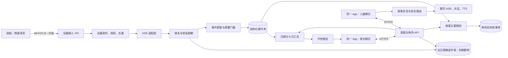
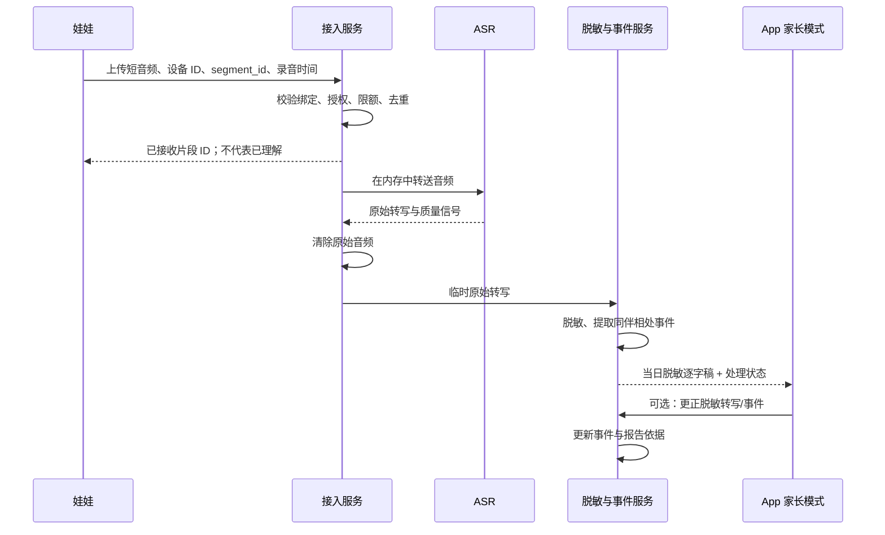
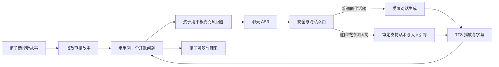

# 同伴相处场景软件产品架构

版本：架构讨论稿 1.0｜2026 年 10 月 11 日  
依据：[同伴相处场景 PRD](同伴相处场景产品需求文档.md)和[总系统架构](儿童陪伴娃娃软硬件系统架构方案.md)。本架构聚焦首个场景：孩子在娃娃端说起与其他小朋友相处的困惑，家长当晚看转写与报告，孩子在同一款 App 的儿童模式中听故事、讨论和问答。

## 1. 关键设计决定

1. **一款 App，两种模式。** 同一安装包运行在 iPhone 和 iPad。家长模式提供当日转写、日报、周期回顾、纠错和设置；儿童模式提供动物角色、故事和语音问答。进入家长模式须验证，服务端也检查家长权限。
2. **娃娃独立上传。** 娃娃经 Wi‑Fi 向后端上传按键录音；BLE 只负责绑定与配置。App 不必持续在后台连接娃娃。当前 M5StickC Plus 原型的上传链路可作为开发起点，但其本地 HTTP 网关尚未满足正式环境的传输和设备身份要求。[现有原型说明](M5StickCPlusVoice/README.md)
3. **ASR 当日可见，跨日只留摘要。** 家长模式在家庭本地日历日内显示**脱敏逐字稿**并可纠错；到次日 00:00 后，界面和后端都不再提供逐字稿，只保留脱敏事件、报告与必要的纠错结果。过期删除由后台任务执行，读取接口也必须检查到期时间，避免清理任务延迟造成越期可见。
4. **原始音频不持久化。** 音频只在设备 RAM、上传链路和服务端处理内存中短暂存在；ASR 完成或失败后清除自有系统中的字节。音频不进普通对象存储、日志、崩溃转储或备份。若未来为了断网重试引入临时音频文件，须单独修改家长告知与本架构。第三方 ASR 的实际保留期限需要按所选供应商核对。
5. **报告和故事有可追溯来源。** 日报引用结构化事件，而不是让模型直接从全部逐字稿写结论；儿童故事只接收年龄、主题及经审核的故事 ID，不接收其他孩子姓名或家长报告原文。

## 2. 软件模块与连接



这里的两个 App 框只是**同一款 App 在不同设备或模式下的运行实例**，共用账号体系、客户端代码和后端。服务端权限按家长会话、儿童会话和设备凭证分别执行；不依赖前端隐藏按钮来保护报告。

首版后端建议是一个模块化服务加后台任务，而非一开始拆很多微服务。模块间通过明确的数据对象和作业状态衔接：设备接入、转写、脱敏/事件、报告、故事、聊天、安全与数据治理。这样后续更换 ASR 或模型供应商时，App 页面与业务事件格式可保持稳定。

## 3. 从录音到软件端展示



### 家长模式的“今日输入”页面

| 状态 | 家长看到的内容 | 允许操作 |
| --- | --- | --- |
| 娃娃已接收 | “收到一条按键留言，正在转写”，显示录入时间。 | 暂无纠错；不显示虚构内容。 |
| 已转写 | 脱敏逐字稿、来源“娃娃按键”、转写质量提示、系统归类“同伴相处”。例如“今天为什么[同伴 A]不跟我玩儿，去跟[同伴 B]玩儿了？” | 标记正确、修改转写、改主题、删除。 |
| 需核对 | “部分内容没有听清”，不自动生成确定事件。 | 家长可从自己已知的情况补充或删除；不能回放原音频，因为本产品不保存原音频。 |
| 次日以后 | 只显示脱敏摘要和报告引用，例如“提到一位同伴转去和别人玩，孩子提出疑问”。 | 更正摘要或删除；逐字稿不再可读。 |

**纠错顺序**：家长改写当日逐字稿后，系统再次脱敏 → 重做事件提取 → 重新生成受影响的日报/七日汇总 → 更新尚未播放的故事推荐。家长的更正属于“家长补充”，报告中与孩子主动表达分开标注。若家长仅改报告结论，不修改逐字稿，也要保留该反馈的来源，避免系统下一次又生成旧说法。

### 存储与过期

| 数据 | 用于什么 | 保存策略 |
| --- | --- | --- |
| 原始音频 | 临时 ASR | 仅易失性缓冲；转写完成/失败即释放。当前硬件断网时不能保证留言被保留。 |
| 原始 ASR 文本 | 脱敏与事件提取 | 仅处理进程中存在，不落普通数据库或日志。 |
| 脱敏逐字稿 | 家长当日核对 | 加密保存至家庭本地次日 00:00；到期自动删除且接口立即拒绝读取。 |
| 结构化事件 | 日报、七日汇总、家长纠错 | 保留中性摘要、来源、时间、主题、明确说出的感受及状态；不保留第三人姓名。首场景 PRD 拟定默认 30 天，家长可提前删除。 |
| 日报与七日汇总 | 家长回顾 | 保存报告版本和引用的事件 ID。首场景 PRD 拟定默认 90 天，家长可提前删除。 |
| 故事聊天会话 | 本次问答接续 | 只保留本次会话所需的最短上下文；会话结束后清理，不默认写入家长日报。 |

“脱敏逐字稿”也可能包含能间接识别孩子或其他人的细节，脱敏不能当成完全匿名。家长模式的查看权限、过期删除、导出与日志管理要按儿童个人信息处理要求实现。[儿童个人信息网络保护规定](https://www.cac.gov.cn/2019-08/23/c_1124913903.htm)

## 4. 家长日报与周期回顾

### 日报生成链

每日家庭本地时间 19:00，报告服务读取该孩子**当天已识别且未删除**的事件。先由规则整理“事实来源、孩子明确说出的感受、未知事项和覆盖范围”，再用受约束的文案模板或模型润色；生成后做安全与事实校验。19:00 之后收到补充事件或家长纠错，生成带修订号的新报告，页面标注“已更新”。通知只写“今日报告已生成”，不把同伴问题放到锁屏。[Apple 儿童应用与隐私要求](https://developer.apple.com/app-store/review/guidelines/)

日报建议固定四块：

1. **今天收到的表达**：例如“娃娃收到一条主动留言，提到一位同伴转去和另一位同伴玩，孩子问为什么。”附时间和“按键留言”来源。
2. **我们还不知道**：不知道现场完整经过、其他孩子的想法，也不能从这条话判断孩子整天的情绪。
3. **家长可以怎么聊**：建议一到三个开放问题，如“你当时最想玩什么？”“后来发生了什么？”“你希望我听你说，还是一起想明天怎么办？”
4. **今晚的故事**：显示推荐的故事主题与是否已播放，不向家长承诺故事会“解决”同伴问题。

当日若仅有一条留言，“整体情况”显示**记录覆盖不足**，不能写“孩子今天整体不开心”。后续若有其他获准的事件类型，可在总日报增加主题概览，但每项都保留证据来源。七日回顾从有效事件计算“提到同伴问题的天数、次数和持续的自述感受”；沉默或未上传不得记为好转。

### 报告对象的最小结构

```json
{
  "report_date": "家庭本地日期",
  "status": "ready | insufficient | failed",
  "revision": 1,
  "coverage": {"button_segments_received": 1, "understood": 1, "unreadable": 0},
  "observations": [{"text": "中性事实描述", "event_ids": ["事件 ID"], "source": "button"}],
  "unknowns": ["其他孩子的想法未知", "不能判断全天情绪"],
  "parent_prompts": ["开放式问题"],
  "story_id": "审核后的故事 ID"
}
```

报告生成失败时保留 `failed` 状态，不能返回一篇看似正常的空洞报告。家长纠错、删除事件后，报告修订号增加，旧版不再作为当前内容展示。

## 5. 儿童模式的故事、讨论和问答

孩子进入同一 App 的儿童模式时，动物角色只得到故事主题 `friendship_and_inclusion`、年龄段和审核后的故事 ID；不接收家长日报、当日脱敏逐字稿或同伴姓名。推荐卡文案是“米米今天有个关于一起玩的故事，想听吗？”孩子可听、换一个、跳过。故事内容以[首场景 PRD](同伴相处场景产品需求文档.md)中的《小猫米米和新的游戏圈》为第一条内容，按 5–7、8–10、11–12 岁各做一版。



**一轮问答**的输入包括：故事 ID、当前问题 ID、最近几轮必要上下文、孩子语音的 ASR 文本、年龄段。对话服务先判断“停止/换话题/安全求助”，再生成不超过孩子年龄理解能力的短句，经输出检查后 TTS。首版目标支持至少三轮自然接续；每轮都能说“不想聊”。普通“为什么她不跟我玩”不触发紧急提醒；“经常被打/害怕回去”等进入单独安全流程。

示例：

> 米米：“米米一开始不知道小兔为什么去搭城堡。你觉得它可以怎样问？”  
> 孩子：“我也不知道甜甜为什么跟裙裙玩。”  
> 米米：“我也不知道她当时怎么想。你愿意先说说，你看到她们在玩什么吗？不想说也可以。”

儿童端不说“我知道你白天说了什么”，不擅自替其他孩子解释动机，不要求孩子提供姓名、班级和地址，也不承诺对危险内容保密。故事或对话内容需审核版本和回退话术。Apple 对面向儿童的应用要求家长门控和儿童数据处理约束，App 录音时也须给出清楚的可见或可听提示。[Apple App Review Guidelines](https://developer.apple.com/app-store/review/guidelines/)

## 6. 一款 App 的页面与权限

| 页面 | 模式 | 核心内容 |
| --- | --- | --- |
| 今日输入 | 家长 | 片段处理状态、当日脱敏逐字稿、质量提示、纠错/删除。次日变成事件摘要。 |
| 今日报告 | 家长 | 当日问题、未知事项、引导问题、故事关联、报告修订号。 |
| 七日回顾 | 家长 | 主题被提到的天数与次数、明确自述的感受、数据覆盖范围。 |
| 孩子与设备设置 | 家长 | 年龄/学段、绑定、按键录音授权、暂停、数据删除。 |
| 米米主页 | 儿童 | 动物状态、故事卡、播放/跳过/换故事。 |
| 故事播放 | 儿童 | 动物表情、插画、播放控制、可选字幕。 |
| 故事聊天 | 儿童 | 录音状态、米米回答、停止和换话题。 |

家长模式使用完成验证后的家长令牌；儿童模式使用只可读故事和提交聊天的限权令牌。家长报告、脱敏逐字稿和设置 API 必须在服务端拒绝儿童令牌。同一台 iPad 切换模式也不能共享家长报告的本地缓存；退出家长模式时清理敏感页面状态。

## 7. 关键接口与事件

| 接口/事件 | 调用者 | 返回或后续动作 |
| --- | --- | --- |
| `POST /device/segments` | 娃娃 | 提交 `segment_id`、时间、来源与音频；返回“已接收”或明确失败。设备使用独立凭证。 |
| `segment.transcribed` | ASR 处理模块 | 将临时原文脱敏，写当日逐字稿，触发事件抽取；释放音频。 |
| `GET /parent/today-inputs` | 家长模式 | 返回当日脱敏逐字稿、处理状态和事件；跨日只返回摘要。 |
| `PATCH /parent/inputs/{id}` | 家长模式 | 更正当日脱敏转写或事件摘要；触发事件/报告重算。 |
| `GET /parent/reports/daily` | 家长模式 | 返回日报、证据引用、版本与状态。 |
| `GET /parent/reports/weekly` | 家长模式 | 返回七日主题汇总与覆盖范围。 |
| `GET /child/story/today` | 儿童模式 | 返回已审核故事、年龄版和可跳过选项，不返回家长报告。 |
| `POST /child/chat-turn` | 儿童模式 | 发送本轮音频/文本和故事会话 ID，返回经过安全路由的回复与 TTS。 |

`segment_id` 用于去重；`event_id` 用于报告证据与纠错；`report_revision` 用于客户端刷新；所有时间在存储中使用统一时间戳，按家庭时区决定“今天”与逐字稿到期时刻。推送消息只携带报告可用状态，不携带逐字稿或具体问题。

## 8. 异常处理与第一版交付顺序

| 异常 | 家长模式 | 儿童模式 |
| --- | --- | --- |
| 娃娃未联网/上传失败 | 不出现“已收到”的输入；设备页显示失败。 | 不因这次未送达留言生成定向故事。 |
| ASR 低质量 | 当日卡显示“没有听清/需核对”；不做确定问题总结。 | 选择中性故事，或让孩子自主选故事。 |
| ASR 把姓名听错 | 家长可当日更正；重新脱敏后再处理。 | 不接收任何同伴姓名。 |
| 19:00 后补到一条事件 | 日报显示“已更新”，修订号增加。 | 尚未开始的故事推荐按新事件刷新；已在进行的故事不中途打断。 |
| 家长删除/撤回 | 立即撤销可见内容并重算报告；设备停止相应收音。 | 不再用已删除事件推荐故事；当前会话按安全方式结束。 |
| 儿童要求停止 | 无需强制生成“孩子拒绝交流”问题。 | 立即停止录音和追问，返回故事主页或休息状态。 |

建议按四个切片开发：**① 设备上传与 ASR 当日展示；② 脱敏事件与日报/七日汇总；③ 同一 App 儿童故事与语音问答；④ 家长纠错、跨日清理和权限/删除验收。** 每个切片都可以用合成语句先验证，真实儿童试用需完成监护人同意、供应商数据处理核对和删除机制。[儿童个人信息网络保护规定](https://www.cac.gov.cn/2019-08/23/c_1124913903.htm)

本架构的最关键验收：示例句的当日脱敏转写可在家长模式看到；次日只剩中性摘要；日报不推断甜甜的动机或孩子全天心情；儿童故事与聊天不泄露家长报告或同伴姓名；孩子说“不想聊”后停止；家长纠错能更新报告和未播放的推荐。
