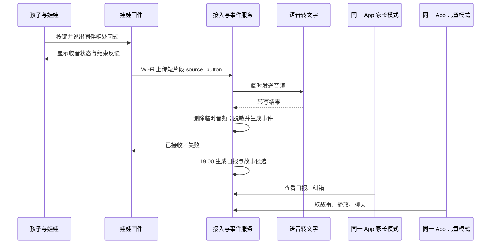

# 同伴相处首个场景开发规格

版本：MVP 场景 0.1｜2026 年 10 月 11 日  
基础：[儿童陪伴娃娃产品需求文档](儿童陪伴娃娃产品需求文档.md)与[软硬件系统架构方案](儿童陪伴娃娃软硬件系统架构方案.md)。目标是在**同一款 App** 的家长模式和儿童模式之间，完成一次可解释的“孩子倾诉 → 家长了解 → 故事陪伴 → 儿童聊天”闭环。

## 场景与成功结果

孩子在娃娃端按键，说：“今天为什么甜甜不跟我玩儿，去跟裙裙玩儿了？”设备明确提示开始、结束和是否上传成功。服务端将这段**孩子主动表达**归为“同伴相处／没有一起玩”，不推断甜甜的动机，也不在长期事件中保留同伴姓名。晚上 19:00 后，家长模式展示事件来源、覆盖范围和建议的开放式提问；儿童模式推荐一篇与“朋友有时会和别人玩”有关的动物故事，并围绕故事与孩子聊天。

验收时至少能完成：娃娃按键音频被成功接收；ASR 文本经人工核对或合成样例输入；事件、日报、故事选择、儿童对话、家长纠错在一个孩子档案下关联；当数据不足时明确写“无法判断整天情况”。首轮只验证**孩子主动倾诉**，家长时段环境感知在技术上保留入口，但不把背景谈话用于此场景的首轮结论。

## 完整业务流程



| 环节 | MVP 行为 | 失败时的表现 |
| --- | --- | --- |
| 娃娃按键 | 按键进入专门录入；LED/屏幕明确亮起；结束后上传。 | 未联网或未获授权：不假装保存成功，清楚提示“没有送达”。 |
| ASR | 产生临时转写和质量标记；文本处理前先判断是否听清。 | 听不清时只记录“有一次未能理解的主动留言”，不编造事件或故事依据。 |
| 事件抽取 | 记录来源、时间、主题、脱敏摘要、孩子明确表达的感受、证据等级。 | 无法确认是否涉及同伴相处时归为“待家长确认”，不进入确定主题统计。 |
| 家长日报 | 19:00 后给出“今天听到什么／不知道什么／家长可怎么问”。 | 只有一条留言时，整体情况写“记录有限，无法判断全天”。 |
| 周报 | 统计七天里主动提到同伴相处的**天数和次数**，不从沉默推断改善。 | 少于足够覆盖时只展示观察到的次数，不输出情绪趋势。 |
| 儿童故事聊天 | 根据年龄选择同主题故事；孩子可换故事、拒绝聊天。 | 故事缺授权/审核时选中性故事或不推荐；模型不可自由编造事件真相。 |

## 数据对象与处理规则

`PeerEvent` 建议最小结构：`event_id`、`child_id`、`device_id`、`occurred_at`、`source=button`、`topic=peer_play`、`summary`、`explicit_feeling`、`transcript_quality`、`attribution=unconfirmed/child_confirmed`、`review_state`、`story_topic`。不持久化原始音频、完整逐字稿、同伴姓名。家长纠错以新修订记录代替原事件参与报告；删除事件后重算日报和周报。

示例处理：

```json
{
  "source": "button",
  "topic": "peer_play",
  "summary": "孩子提到一位同伴转去和另一位同伴玩，并对此表示不理解。",
  "explicit_feeling": null,
  "attribution": "unconfirmed",
  "story_topic": "friendship_and_inclusion"
}
```

`explicit_feeling` 留空，因为原句没有直接说“难过”或“生气”；孩子只是提出“为什么”。即便是主动按键，单麦克风也不能单凭设备判断是谁在说话。把人名从长期记录移除，是为了减少对其他孩子的无必要收集。儿童个人信息处理应遵循目的明确、必要、保留期限和监护人同意要求。[儿童个人信息网络保护规定](https://www.cac.gov.cn/2019-08/23/c_1124913903.htm)

## 家长模式呈现

### 当晚日报示例

> **今日关注：同伴相处**  
> 孩子今天通过娃娃主动提到：一位原本一起玩的同伴转去和另一位同伴玩，孩子想知道为什么。我们尚不知道当时的完整经过，也不知道其他小朋友的想法。  
> **整体情况：**目前只有这一条主动留言，无法判断孩子全天的心情或在其他时间与同伴的相处情况。  
> **今晚可以这样聊：**“你当时想和她们玩什么？”“后来你做了什么？”“你希望我听你说，还是一起想明天可以怎么邀请朋友？”  
> **儿童端准备：**一篇关于朋友有时会去参加别的游戏、也可以表达自己想一起玩的动物故事。孩子可选择跳过。

如果一天中有多条**可靠且获准使用**的事件，“整体情况”可以概括不同主题和覆盖时段，但须分别注明来源。不能因为娃娃没收到片段，就写成孩子“全天开心”或“没有问题”。敏感通知只提示“今日报告已生成”，详情进入家长模式并验证后查看。

### 周期报告示例

> 过去 7 天，孩子有 2 天、共 3 次主动提到与同伴一起玩的困惑。其中 1 次提到“想加入游戏”，另 2 次只是问“为什么没有一起玩”。这些记录说明孩子在留意同伴关系；现有资料不足以判断是否长期被排斥。建议先与孩子回顾具体场景；若类似困扰持续出现且孩子愿意，可与老师了解情况。

周报只统计可追溯事件；家长纠错后重算。图表可显示“提到同伴相处的天数/次数”，不显示未经验证的“孤独指数”或心理评分。

## 儿童模式的故事与对话

儿童模式展示动物角色“米米”，推荐理由只说“今天有个关于一起玩的故事”，不念出孩子白天的话，也不说同伴姓名。年龄分层：5–7 岁用短句和明确动作；8–10 岁加入多种可能；11–12 岁允许讨论误会、边界和选择，但不把关系问题简化为固定答案。

### 第一篇原创故事梗概

**《小猫米米和新的游戏圈》**。米米拿着纸飞机去找小兔玩，小兔正和小熊搭城堡。米米一开始以为“他们不想跟我玩了”，但它并不知道原因。它先在旁边看了看，问：“我能帮你们做一扇门吗？”小兔说今天城堡快搭好了，明天可以一起飞纸飞机。米米既可以等一会儿，也可以找小松鼠先玩纸飞机；它决定先玩自己喜欢的游戏，明天再邀请小兔。故事不保证每次邀请都会成功，而是让孩子看到“问清楚、表达想法、选择别的伙伴或活动”几个可能动作。

正式发布前，故事文本、插画、配音、角色形象及许可分别入台账，并由适龄内容人员审阅。首版故事可以原创；开放故事库只作为题材与结构参考，[StoryWeaver](https://storyweaver.org.in/en/open-content)等平台的文本、插画和 readalong 授权并不相同。

### 故事后聊天样例

| 儿童说 | 米米可回应 | 目的 |
| --- | --- | --- |
| “米米好像我。” | “原来你也有过像米米这样的时刻。你愿意说说，当时你最想做什么吗？” | 接住感受，允许不回答。 |
| “甜甜是不是讨厌我？” | “我不知道甜甜是怎么想的。我们可以先想想你看到和听到了什么；如果你愿意，也可以问问她明天想玩什么。” | 不替第三人下结论。 |
| “我不想讲了。” | “好呀，我们可以停在这里。想听下一段故事，还是休息一下？” | 尊重退出。 |
| “她们每天都不让我玩，我好难过。” | “这听起来很难受。你想让我陪你把这件事说给爸爸妈妈或其他信任的大人听吗？” | 关注持续困扰，引向可信任大人。 |

对话不要求孩子提供更多同伴姓名、学校、班级或家庭隐私；不承诺“替你保密”，不声称自己知道其他孩子的真实动机。风险或求助话题走人工审定的安全流程，不由普通故事模型自由发挥。[ai-child 安全设计参考](https://github.com/ronaldowzy/ai-child) · [Pupbox 规则参考](https://github.com/donychen1134/pupbox)

## 软件接口切片

| 接口 | 调用方 | MVP 回应 |
| --- | --- | --- |
| `POST /device/segments` | 娃娃 | 接收 `source=button` 短音频，返回接收 ID；ASR 异步运行。当前实验固件的 `/v1/utterances` 可作为适配入口。 |
| `GET /parent/reports/daily?date=...` | 同一 App 家长模式 | 返回覆盖范围、主动表达事件、未知事项、开放式引导和故事关联。 |
| `GET /parent/reports/weekly?week=...` | 同一 App 家长模式 | 返回七天事件天数/次数、家长纠错后的汇总与数据不足提示。 |
| `POST /parent/events/{id}/feedback` | 同一 App 家长模式 | 更正、隐藏或删除事件并触发报告重算。 |
| `GET /child/story/today` | 同一 App 儿童模式 | 返回适龄、已审核故事及可跳过选项，不返回家长报告。 |
| `POST /child/chat-turn` | 同一 App 儿童模式 | 围绕故事回应，使用受限会话；危险话题转安全路由。 |

同一 App 的家长模式与儿童模式必须由服务端检查不同权限，页面切换本身不授予报告读取权。App 录音时须清楚提示，并遵循儿童应用相关审核与家长门控要求。[Apple App Review Guidelines](https://developer.apple.com/app-store/review/guidelines/)

## 开发顺序与验收用例

1. **场景业务内核**：用合成语句验证主题识别、同伴姓名脱敏、日报与周报措辞；同步建立故事和对话模板。配套的[可运行样例](PeerFriendshipScenario/README.md)只处理合成文本，不收集真实儿童信息。
2. **接入现有音频原型**：将设备按键音频送至 ASR，结果进入事件处理；保留“未听清/未上传”的真实状态。当前设备固件只支持短按键录音及本地 HTTP 网关，TLS 和设备身份需在试用前补齐。[实验工程说明](M5StickCPlusVoice/README.md)
3. **同一 App 双模式**：家长模式做日报/周报与纠错；儿童模式做动物角色、故事与聊天；切换家长模式经验证，服务端执行权限控制。
4. **七天试验**：用获授权的测试记录核对事件准确性、ASR 误听、报告可理解性、故事是否让孩子觉得被贴标签。再决定是否增加时段环境感知。

必须通过的用例：原句不推断“甜甜讨厌我”；原句不写“孩子难过”；只有一条记录不形成全天心情判断；同伴姓名不进入持久事件；未听清时不生成同伴相处结论；重复上传只记一次；家长删除后周报重算；儿童模式无法读家长报告；孩子说“不想聊”后停止追问。
