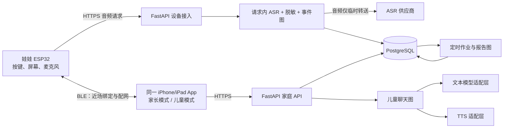
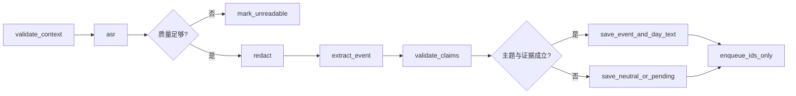

# 同伴相处首场景完整技术方案

版本：研发讨论稿 1.0｜2026-10-11  
范围：娃娃按键留言、家长当日 ASR 展示及 19:00 日报、同一 App 儿童模式的故事和问答。  
依据：[场景 PRD](同伴相处场景产品需求文档.md)、[软件产品架构](同伴相处场景软件产品架构.md)、[现有硬件原型](M5StickCPlusVoice/README.md)。

> **状态说明**：本文是拟实施的技术设计，并不表示下述云服务、移动 App、LangGraph 工作流或安全机制已经实现。现有原型是 M5StickC Plus 1.1 + 本地 Mac HTTP 网关 + 实验 App；只有短录音链路和合成语句业务逻辑可复用，不能直接用于真实儿童试用。

## 1. 目标、边界与关键决定

本场景的完整闭环：孩子按娃娃按键说出同伴相处的事 → 娃娃以 Wi‑Fi 上传 → 服务端 ASR、脱敏、事件抽取 → 家长在**同一款 App 的家长模式**当日查看脱敏逐字稿与处理状态 → 家庭本地时间 19:00 生成日报 → 孩子在**该 App 的儿童模式**听审核过的故事，并用平板麦克风围绕故事问答。家长可纠错或删除，日报和未播放的推荐随之更新。

首版只用 `source=button` 的主动留言触发报告与推荐。家长设时段的环境收音是总产品规划，不进入本场景的数据处理链。学校或幼儿园等多人场所的录音场景须单独完成场所规则和在场人员告知评估，首轮验证放在完成授权的家庭环境。

**技术决定：**

| 层 | 首版选型 | 选择理由及边界 |
| --- | --- | --- |
| iPhone/iPad App | SwiftUI、同一安装包两种模式 | 与现有 SwiftUI 实验 App 衔接；家长和儿童权限仍由服务端区分。首版不要求 Mac 消费端。 |
| API 服务 | Python + FastAPI 模块化单体 | 一处承载设备接入、家庭权限、事件、故事与报告 API；内部按模块分界。 |
| AI 流程 | LangGraph `StateGraph` | 固定节点、条件路由、可测试的状态转移。首版不用自由规划或多 Agent 互相交接。 |
| 模型接入 | `AsrProvider`、`TextProvider`、`TtsProvider` 三个适配接口 | 供应商可替换；密钥只在服务端。儿童问答若确定使用 OpenAI，可在节点内用 Agents SDK，但不把它当作家长权限、持久化或审核系统。 |
| 事务数据 | PostgreSQL | 家庭、设备、片段元数据、当日脱敏逐字稿、事件、报告和故事版本。 |
| 作业 | Celery + Redis/RabbitMQ，或同等可靠队列 | 只传不含音频/逐字稿的 ID 与版本号；运行报告、清理及重算。开发机可先用数据库作业表模拟。 |
| 文件/音频 | 不使用持久化对象存储保存原始录音 | 原音频仅在设备 RAM、TLS 上传请求与 ASR 调用期间短暂存在。失败可丢失，界面必须如实告知。 |

FastAPI 官方文档建议将较重且独立于请求进程的任务交给 Celery 等工具；但**原音频不能进入该队列**。LangGraph 官方文档说明检查点会保存图状态，因此本方案对含音频或逐字稿的图不启用持久检查点。[FastAPI 后台任务](https://fastapi.tiangolo.com/tutorial/background-tasks/) · [LangGraph 持久化](https://docs.langchain.com/oss/python/langgraph/persistence) · [Celery 任务与幂等](https://docs.celeryq.dev/en/stable/userguide/tasks.html)

## 2. 系统部署与信任边界



### 服务模块

1. `identity`：家庭账号、监护人验证、儿童档案、家长/儿童令牌与授权记录。
2. `device`：娃娃认领、设备凭证、固件版本、健康状态、暂停与配置 ACK。
3. `ingest`：设备鉴权、音频限额、幂等、ASR 同步调用、失败清理。
4. `analysis`：脱敏、质量门槛、同伴事件、来源标记、安全分流。
5. `reports`：19:00 日报、七日汇总、纠错重算、版本控制。
6. `stories`：审核后故事库、年龄版、推荐和播放记录。
7. `chat`：儿童语音问答、安全路由、有限会话上下文、TTS。
8. `governance`：数据到期、撤回、删除、供应商配置、非内容审计。

所有客户端经同一个 API 服务访问数据。设备凭证、家长会话、儿童会话分开签发；仅 UI 切换不改变服务端权限。服务端按 `family_id + child_id` 做对象级检查，拒绝跨家庭 ID 猜测访问。

## 3. 娃娃到 ASR 的传输协议

### 3.1 设备状态

`idle → recording → uploading → processing → delivered/failed → idle`。按键开始/再次按键结束；达到时长上限自动结束。LED 与屏幕的“正在收音”严格对应麦克风启用状态。`delivered` 表示 ASR/事件链已经给出可展示的结果，不能在仅收到 TCP 字节时显示“系统已理解”。如设备需要更早反馈，可另设“已上传，处理中”，不能冒充成功。

首版目标录音最长 10 秒，音频格式可先沿用原型的 16 kHz、单声道 PCM16 WAV；10 秒原始 PCM 约 320 KB，是否能在板上稳定缓冲必须实测。若不足，改为分块上传/流式 ASR 或评估压缩编码，**不以写入闪存作默认解决办法**。设备断网、服务端超时或 ASR 失败时清除 RAM 缓冲并显示“没有送达/未理解”。

### 3.2 接口约定

`POST /v1/device/segments`：设备经 TLS 上传二进制音频，并提交 `segment_id`、`device_id`、`captured_at`、`source=button`、`firmware_version`、音频格式/采样率、内容长度。服务端限制时长、大小、并发和日次数；设备凭证与绑定儿童、监护人授权、暂停状态逐次核验。服务器时间是权威时间；设备时间用于显示和异常检测，漂移过大则标记待核对。

`segment_id` 在同一设备下唯一；服务端用 `(device_id, segment_id)` 唯一约束去重。重复请求返回同一处理结果，不重复生成事件。请求的最终响应为：

| 结果 | 设备显示 | 服务端动作 |
| --- | --- | --- |
| `accepted/understood` | 已送达 | 已写入脱敏逐字稿和事件；向家长端开放。 |
| `accepted/unreadable` | 已送达，未听清 | 只保留不含原文的状态；不生成确定事件。 |
| `rejected` | 没有送达 | 鉴权、授权、大小或格式失败；不入报告。 |
| `retryable_failure` | 没有送达 | 请求内处理失败；设备在 RAM 仍在且窗口未过时可按同一 ID 有限重试。 |

**关键一致性约束**：在“不持久保存原音频”前提下，不能发出一个“已经可靠收到、稍后必定会处理”的确认，然后把音频交给普通后台队列。若设备与 ASR 调用中断，且音频 RAM 消失，该留言会丢失。本方案选择在请求内完成 ASR 与必要事务提交后才向设备给最终成功响应。API 超时、供应商超时与设备电量影响体验，须用真机测量；后续若要离线可靠送达，需重新设计加密临时存储、到期清理和告知规则。

**部署核查**：关闭入口代理的请求体落盘缓冲，避免框架的 multipart 上传解析器把大文件自动写入临时目录；检查反向代理、ASR SDK、系统交换空间、core dump、APM 和崩溃报告的配置。若选用的组件无法做到音频仅短暂驻留内存，不能宣称“原音频不存储”，须调整组件或重新获得对应授权。最终响应若在数据库提交后丢失，设备使用同一 `segment_id` 重试时由幂等记录返回既有结果。

## 4. LangGraph 流程设计

**原则**：图负责步骤和分支；规则负责硬权限与时限；模型只做受约束的语言任务。任何图的输入/输出都通过 Pydantic 等结构校验。不能把家长权限、逐字稿过期、安全提醒完全交给模型判断。

### 4.1 录音理解图 `IngestGraph`



`asr` 可以处理原音频，但**整个图不设持久 checkpointer**；含原文的状态只在当前请求进程内。`redact` 先处理人名、学校、地址、电话号码等明显标识，再二次检查上下文中的间接识别信息。`extract_event` 生成结构化候选，字段包括中性事实、孩子**明确说出**的感受、未知事项、主题、质量标志和证据短语。事件校验器禁止从“她跟别人玩儿”推断“她讨厌我”或“孩子整天被排斥”。

写库事务同时写片段状态、当日脱敏逐字稿、事件及受限审计字段。事务提交后才发最终成功响应；报告重算作业通过事务后 outbox 发布，队列消息仅含 `child_id, event_id, revision`。原始 ASR 字符串、音频字节、完整模型提示词不得进入队列、持久图状态、普通追踪或错误日志。

### 4.2 日报图 `DailyReportGraph`

`load_event_ids → assemble_facts → coverage_gate → draft_report → validate_evidence_and_language → commit_revision`。

19:00 由家庭时区调度器触发，读取当天有效且未删除的主动留言事件。`assemble_facts` 用代码计算片段数、成功理解数、明确自述感受和缺失信息。`coverage_gate` 对空白/单条/低质量数据输出覆盖说明。文案模型只可在事实包范围内表述；输出结构为 `observations[]`（每条带 `event_ids`）、`unknowns[]`、`parent_prompts[]`、`story_topic`。校验器检查引用存在、没有第三人姓名、没有诊断和动机推断；失败则返回规则模板并将报告标记为待核对/受限，不展示伪装成完整结论的文本。

`(child_id, local_date, source_revision)` 为幂等键。19:00 后新增有效事件或家长纠错时，`source_revision` 增加，生成新报告；旧版本仅保留必要版本审计且不作为当前界面结果。若纠错删除要求删除相关内容，旧报告正文也须同步清理或重算，不能以“历史版本”为由保留已删除的儿童信息。

### 4.3 儿童问答图 `ChildChatGraph`

`load_approved_story → chat_asr → classify_stop_and_safety → formulate_reply → output_review → tts → return_turn`。这是一个**受控单 Agent 对话**：只可调用审核故事、当轮年龄版、最近几轮必要上下文和预设支持话术。停止、换故事、无声、疑似伤害/持续害怕等首先走规则/分类分支；命中停止时不调用生成模型继续追问。普通同伴话题在输出检查后由 TTS 播放，并显示字幕。

儿童图不会读取家长日报、当日脱敏逐字稿、同伴姓名或完整儿童档案。由报告侧给故事侧的输入是白名单字段：`child_id, age_band, approved_topic, story_id, recommendation_version`。孩子在聊天中自己说出姓名等信息，只用于当前轮处理，先脱敏后进入有限上下文；聊天内容默认不自动形成家长日报事件。若安全路由识别需要大人关注的表达，使用单独、明确告知和可审计的提醒规则，不能从普通同伴困惑自动升级。

**LangGraph 状态保留策略**：三个图的持久状态只放 ID、状态码、来源版本和已经脱敏的最小摘要；涉及原音频、原始 ASR、当日逐字稿或儿童聊天原话的节点禁用持久 checkpointer 和默认内容追踪。聊天会话若需要跨 API 实例连续，单独使用短 TTL、加密且可删除的最小上下文存储；不得直接采用无期限的 SDK Session/Graph Store。框架的检查点可能保存整份状态，需要逐字段测试和审计。[LangGraph 持久化说明](https://docs.langchain.com/oss/python/langgraph/persistence)

## 5. 数据模型与生命周期

建议表结构如下；字段类型和索引在实现时用迁移脚本固定，所有对象有 `family_id` 与对象级授权校验。

| 表/对象 | 关键字段 | 生命周期 |
| --- | --- | --- |
| `family`, `guardian`, `child_profile` | ID、家长身份、年龄段/学段、时区、设置版本 | 随账号；删除账号时按删除流程处理。 |
| `device`, `device_binding` | 设备 ID、硬件修订、固件版、凭证指纹、绑定与最后同步 | 至解绑/账号删除；密钥不以明文保存。 |
| `consent_record` | 子项、版本、同意/撤回、时间、主体 | 单独保存必要的授权证明和删除审计，不保存内容。 |
| `segment_meta` | 片段 ID、设备 ID、儿童 ID、来源、时间、状态、质量码 | 只留处理追踪所需字段；不含音频和原始逐字稿。 |
| `day_transcript` | `segment_id`、加密的脱敏文本、`expires_at`、版本 | **家庭本地次日 00:00 到期**；读取先检查到期，清理作业随后物理删除。 |
| `child_event` | 事件 ID、来源、主题、中性摘要、明确感受、置信/核对状态、修订号 | 首版建议默认 30 天，家长可提前删除。 |
| `daily_report`, `weekly_report` | 日期、来源事件 ID、覆盖范围、文案、修订号、状态 | 首版建议默认 90 天；来源删除时立即重算或删除相应正文。 |
| `story`, `story_version` | 审核状态、年龄版、文本/音频资产、授权与版本 | 内容库由编辑审核；不存儿童原话。 |
| `recommendation` | 儿童 ID、日期、主题、故事 ID、事件版本 | 来源事件删除后失效并重算。 |
| `chat_session` | 会话 ID、故事 ID、短期脱敏上下文、到期时间 | 最短必要期限；结束/撤回时清理，不进入普通备份。 |
| `audit_event` | 操作人类型、对象 ID、动作、时间、结果 | 仅非内容元数据；按批准的审计期限保留。 |

**跨日规则**：存储时间统一用 UTC；展示与“今天”、19:00 调度、逐字稿到期都按绑定家庭的 IANA 时区计算。逐字稿到期时刻在创建时固化为 `expires_at`；之后家长改时区不延长已存逐字稿寿命，采用原到期与新时区次日 00:00 中较早者。恰在午夜后完成处理的片段只生成摘要，不新建已过期的“昨天逐字稿”。

**删除规则**：应用层读取首先拒绝过期或已删除记录；清理作业删除主库与可控缓存、索引及队列残留，日志不存正文。数据库备份、灾备快照和第三方 ASR/LLM/TTS 的保留方式须在真实儿童试用前逐项确认；若备份不能逐条擦除，需设置短保留与恢复后重放删除清单，并在对家长的说明中准确披露。不要将“隐藏”描述为“物理删除已完成”。

中国儿童个人信息处理涉及监护人同意、最小必要、期限、查阅/更正/删除等要求；具体上线地区和处理方式需在真实试用前做法律与供应商合同核验。[儿童个人信息网络保护规定](https://www.cac.gov.cn/2019-08/23/c_1124913903.htm)

## 6. API 契约与权限

| API | 凭证 | 主要响应/副作用 |
| --- | --- | --- |
| `POST /v1/device/segments` | 设备 | 请求内完成 ASR/处理，返回最终状态、`segment_id`；音频不进入异步消息。 |
| `GET /v1/parent/inputs?date=` | 家长 | 当日返回脱敏逐字稿与状态；到期后只返回事件摘要。服务端逐条检查 `expires_at`。 |
| `PATCH /v1/parent/inputs/{id}` | 家长 | 当日更正脱敏逐字稿或随时更正摘要；`If-Match` 修订号防覆盖，重算事件/报告。 |
| `DELETE /v1/parent/inputs/{id}` | 家长 | 撤销可见内容，删除相应事件及逐字稿，触发报告/推荐重算。 |
| `GET /v1/parent/reports/daily?date=` | 家长 | 状态、覆盖范围、四段内容、`revision`、来源引用。 |
| `GET /v1/parent/reports/weekly?end_date=` | 家长 | 七日主题次数/天数、明确感受和覆盖范围。 |
| `GET /v1/child/story/today` | 儿童 | 审核故事、年龄版和推荐主题；不返回报告与逐字稿。 |
| `POST /v1/child/chat-turns` | 儿童 | 本轮短音频/文本、故事会话 ID；返回字幕、TTS 播放信息和安全状态。 |
| `POST /v1/parent/devices/{id}/pause` | 家长 | 更新服务端授权/暂停状态，设备下次上传也被拒绝；设备收到策略 ACK 后显示已执行。 |

家长令牌需通过家长验证获取，儿童令牌只含儿童故事/聊天作用域；设备令牌只含该设备片段上传和配置读取权限。儿童端不能通过构造 URL 或枚举 ID 访问家长接口。退出家长模式后清除 App 内敏感页面状态、离线缓存和剪贴板可能保留的逐字稿。TLS、证书与设备凭证轮换、限流、输入校验和数据加密在家庭试用前作为上线门槛。现有 HTTP 本地网关只能用于受控实验。[Apple App Review Guidelines](https://developer.apple.com/app-store/review/guidelines/)

接口错误结构统一包含 `code`、`request_id`、`retryable` 和可显示的中性消息；不返回模型提示词或儿童原话。列表接口分页并限制时间范围。`POST /child/chat-turns` 由家长先在该设备创建有限期儿童会话；服务端验证会话与孩子档案、故事版和麦克风授权一致。所有更改类接口使用 `Idempotency-Key` 或对象修订号防止弱网重发造成重复操作。

## 7. 家长与儿童端实现

### 家长模式

1. **今日输入**：片段处理状态 → 当日脱敏逐字稿（若质量允许）→ 主题和质量提示 → 纠错/删除。次日同一条卡片只显示摘要；App 本地不保留过期逐字稿。
2. **今日报告**：19:00 后显示“收到的表达 / 还不知道什么 / 家长可问什么 / 今晚故事”。家长可点事件来源和反馈误解。单条片段明确提示“不能代表全天整体情况”。
3. **七日回顾**：只统计有记录的天数与次数、孩子明确说出的感受；缺失天数标记无数据。
4. **设置**：年龄/学段、设备绑定、按键授权、暂停/撤回、数据删除。首次进入家长模式和从儿童模式返回需要家长验证。

### 儿童模式

动物主页展示已审核的“关于一起玩的故事”，可听、跳过、换故事；故事后才进入可选问答。聊天先播放/显示动物提问，孩子在 iPad/iPhone 上点麦克风答，ASR → 安全路由 → 简短回复 → TTS。麦克风启用有明显 UI；说“不想聊”立即停止。儿童主页不复述白天留言；故事主题来自事件分类，不引入同伴姓名。故事按 5–7、8–10、11–12 岁各有审核版本。Apple 对儿童应用和录音提示有相应要求，提交 App 前需按实际分类、功能及数据实践复核。[App Review Guidelines](https://developer.apple.com/app-store/review/guidelines/)

## 8. 内容、模型与质量门槛

**ASR**：供应商须支持普通话儿童语音的实验评测，并提供数据使用、保留、区域和删除条款。使用固定合成与经授权的测试集评估儿童口音、噪声、多人说话、名字识别。低置信或文本不完整时显示“需核对”，不做确定报告。麦克风 VAD 不等于儿童本人声纹认证；报告只能标注“绑定娃娃收到的主动留言”。

**文本模型**：`TextProvider` 统一输入/输出 schema；每次调用带 `prompt_version`、模型版本、超时与预算。事件抽取与报告生成有不同提示词和校验器。引用证据必须能追溯 `event_id`，无证据的感受和同伴动机不能进入报告。模型返回不合 schema、包含个人姓名、越界推断或超时则用规则模板/待核对状态降级。

**故事库**：首版至少一篇同伴相处主题故事的三个年龄版，保存文本、画面、配音、版权/授权、审核记录及版本。推荐只在通过审核的故事 ID 里选择，生成模型不能临时编造未经审核的长故事。对话可围绕故事提开放问题，但需使用审核过的边界话术和输出校验。

**安全路由**：停止/换话题、隐私信息、普通同伴困惑、持续排斥/受伤/害怕、紧急风险分层。普通困惑给选择与开放问题；持续伤害或危险表达提供审定支持话术，提示找可信任的大人，并按经确认的规则提醒家长。儿童端不承诺保密，不作诊断，不替其他孩子解释动机。若 ASR 低质，回复不假装听懂。

## 9. 作业、容错与可观测性

19:00 作业按家庭时区生成；并发争用由数据库唯一键或作业锁防重。时区夏令时切换按 IANA 规则处理，一个本地日期只生成一个基础日报，后续变化形成修订版。日报失败显式标记 `failed`，有限重试，超过阈值进入人工/运维待处理清单；家长模式仅展示已就绪的结果。本轮不做手机系统推送。

家长纠错和删除采用事务更新 `event_revision`，并将只含 ID 的 outbox 事件交给作业队列。工作进程按版本检查，旧作业不覆盖新报告。Celery 等队列可能重投，所有作业须幂等；消息体不携带音频、原始/脱敏逐字稿、儿童聊天原话。队列和模型供应商失败不能使数据过期/删除检查失效。[Celery 任务文档](https://docs.celeryq.dev/en/stable/userguide/tasks.html)

日志和指标仅记录 `request_id`、匿名化/随机化对象 ID、耗时、字节数、状态码、错误类别、模型版本、文案校验通过率、逐字稿清理延迟、报告生成延迟、权限拒绝计数和设备上传成功率。关闭请求正文、模型输入输出、音频、ASR 原文、脱敏逐字稿、儿童聊天文本的默认日志与追踪；异常堆栈和 APM 也要检查。儿童真实数据不得进入开发调试环境或提示词分析平台，除非完成单独授权和脱敏评估。

## 10. 端到端验收与验证数据

先用合成数据；真实儿童试用前另行做监护人同意和供应商处理审查。验收用例至少覆盖：

| 场景 | 必须观察到的结果 |
| --- | --- |
| “甜甜不跟我玩，去跟裙裙玩儿了” | 家长当日看到代称逐字稿；事件只写孩子对一次互动有疑问；报告不写谁讨厌谁或孩子全天不开心。 |
| 当日 23:59 上传，00:01 才完成 | 不新建可读的过期逐字稿；只保留可用的脱敏事件摘要；昨天报告按版本更新。 |
| 午夜清理作业延迟 | `GET /parent/inputs` 仍拒绝返回过期逐字稿；缓存也不展示。 |
| 重复 `segment_id` 上传 | 只生成一次事件、一次计数；设备拿到一致结果。 |
| 断网/ASR 超时/设备断电 | 不承诺已送达；不产生伪造转写或报告；服务端不遗留原始音频。 |
| 家长更正与删除 | 报告修订、七日汇总与未播放推荐更新；旧报告正文不继续对外展示。 |
| 儿童令牌访问家长 API | 服务器返回拒绝，不能靠前端隐藏按钮保护。 |
| 孩子说“不想聊”或沉默 | 停止录音和追问；不会写成“孩子拒绝社交”。 |
| 孩子问“她是不是讨厌我” | 角色承认不知道对方想法，给孩子选择，不判断他人动机。 |
| 内容流入框架检查点/队列/日志 | 自动检查和人工抽查均找不到原音频、原始 ASR、过期逐字稿或聊天原话。 |

性能目标作为实验门槛而非已达成指标：按键结束到家长端可见状态的 P95、设备上传成功率、ASR 可理解率、19:00 日报完成率、故事问答往返延迟、逐字稿到期删除延迟，均在受控样本试验后设数值。首轮不以单次演示成功替代儿童语音与弱网测量。

## 11. 实施顺序和交付物

| 阶段 | 研发交付 | 通过条件 |
| --- | --- | --- |
| 0. 合成数据基线 | 固定 JSON schema、场景样例、报告与对话黄金用例、供应商保留条款清单 | 事件与报告的禁推断用例通过；故事内容完成审核。 |
| 1. 娃娃上传与当日 ASR | 设备 TLS/凭证、请求内 ASR、脱敏逐字稿、今日输入页、失败状态 | 真机重复/断网/午夜测试；无原音频持久化。 |
| 2. 日报和纠错 | 事件图、19:00 调度、报告图、纠错/删除、七日汇总 | 证据可追溯，缺数据不下结论，删除后旧结论不可见。 |
| 3. 儿童故事问答 | 同一 App 儿童模式、故事三年龄版、聊天图、ASR/TTS、安全路由 | 至少三轮自然接续；停止和高风险分支测试。 |
| 4. 家庭试用门槛 | 授权与撤回、删除及备份规则、供应商合同、权限隔离、审计与故障预案 | 通过隐私/安全评审和小范围授权试验后再使用真实儿童数据。 |

### 明确待验证的设计输入

1. 现有 M5StickC Plus 1.1 对 10 秒音频的 RAM、Wi‑Fi/TLS 与 BLE 共存能力；必要时缩短片段或流式传输。
2. 真实儿童普通话语音的 ASR 质量、延迟与供应商保留策略；供应商选定后再锁定模型参数。
3. App 是否只覆盖 iPhone/iPad；本方案按此实施，Mac 维持研发调试端。
4. 当日逐字稿、事件与报告的确切期限及备份清除 SLA；文中的 30/90 天为 PRD 建议值，需在试用前确认。
5. 家庭时区的初始值和迁移规则、19:00 后新事件/纠错的报告更新展示方式。

**技术核心**：在研发实现中，先把“音频不持久化、当日逐字稿跨日不可读、模型只能引用有效事件、儿童端永远拿不到家长原文”做成可自动验证的系统边界，再逐步提升 ASR、故事和对话体验。

## 12. 建议代码分层与环境配置

```text
app/
  api/            # 家长、儿童、设备三个权限入口
  auth/           # 令牌、家庭归属、对象级授权
  devices/        # 绑定、策略、状态与固件信息
  ingest/         # 无落盘音频接入、ASR、幂等
  graphs/         # ingest_graph、report_graph、chat_graph
  providers/      # ASR/Text/TTS 适配接口及供应商实现
  domain/         # 事件、报告、故事、纠错与安全规则
  persistence/    # 数据库模型、迁移、事务 outbox
  jobs/           # 19:00 调度、重算、过期清理
  tests/          # 合成用例、权限、跨日、删除和故障注入
ios-app/          # SwiftUI 共用 App：家长模式与儿童模式
firmware/         # M5StickC Plus 实验固件的后续迭代
```

开发、预发布、生产环境使用不同数据库、密钥、设备凭证和供应商项目。开发环境只放合成数据；预发布真机测试须使用经授权的测试样本。上线配置按环境固定 `API_BASE_URL`、家庭时区、模型/提示词版本、供应商端点、报告触发时间、逐字稿到期策略和数据保留参数；生产密钥经密钥管理服务注入，不写进固件、App、仓库或日志。发布采取数据库迁移向前兼容、灰度设备/家庭、快速回退和事件 schema 版本管理。
