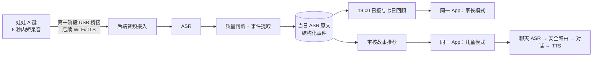

# 同伴相处首场景端到端实施计划

版本：执行计划 1.0｜2026-10-11  
目标：用当前 M5StickC Plus 娃娃完成**按键录音 → ASR → 当日原文转写记录 → 19:00 家长报告 → 儿童端相关故事与语音问答**。前端代码由用户稍后提供；本计划先推进硬件接入、后端和 Agent，待前端入库后按接口契约集成。

**2026-10-11 范围调整**：七日报告已从当前首场景交付和后端 API 移除。本轮优先完成儿童端故事 TTS、故事后开场提问、语音对话和退出流程。本文以下提到的七日回顾均为早期计划，不作为当前验收项；最新接口以 [backend/README.md](../backend/README.md) 和 [OpenAPI](../backend/openapi.json) 为准。

**本轮验证变更**：家长端当日直接显示 ASR 文字，**跳过姓名替换和文本脱敏节点**。当天转写仍只在家长模式可见，家庭本地次日 00:00 后只留事件摘要；原始音频不持久保存。正式儿童试用前再决定是否恢复脱敏及其规则。[完整技术方案](同伴相处首场景完整技术方案.md)中的脱敏设计属于后续产品方案，不是本轮功能验证的交付项。

关联资料：[首场景 PRD](同伴相处场景产品需求文档.md) · [完整技术方案](同伴相处首场景完整技术方案.md) · [后端现有工程](../backend/README.md) · [当前固件说明](M5StickCPlusListeningFirmware/README.md)。

## 一、现状与本轮边界

### 当前已确认或有记录的能力

| 部分 | 当前状态 | 对实施的影响 |
| --- | --- | --- |
| USB 设备 | 本轮在 Mac 看到 `/dev/cu.usbserial-59526C1D38`。未通过串口再次读取固件运行状态。 | 可作为下一轮真机验证入口；计划不假定仅凭端口就能证明录音工作。 |
| 娃娃固件 | 工作区记录显示 M5StickC Plus 1.1、ESP32-PICO-D4；Listening 页面按 A 开始、再次按 A 停止，最长 6 秒，16 kHz 单声道；USB 桥接实测过音频，Wi‑Fi 也有旧协议。 | 首个真实音频实验可先不刷机；6 秒不够或协议需要设备幂等 ID 时再改固件。 |
| USB 桥接 | 可从串口接收 ADPCM，在 Mac 内存解码 WAV，再发 `POST /v1/utterances`。 | 先避开已记录的 VPN 对设备→Mac 局域网连接的阻断。桥接协议和返回状态需改造。 |
| 旧本地网关 | 有 ASR→文字回复→TTS 代码及 mock 模式；HTTP 202 只表示已接收，任务结果保存在进程内。 | 可借鉴 OpenAI 调用和 WAV 校验；不能作为首场景正式数据与权限后端。 |
| 新后端 | `backend/` 已有 FastAPI、3 个 LangGraph 样例图、演示 API/OpenAPI；4 个合成数据接口测试通过。真实音频接口故意返回 503，存储为内存。 | 下一步在此工程新增真实音频接入、供应商适配、持久化与权限。 |
| 前端 | 用户表示代码稍后推送，当前未纳入本轮接口适配。 | 后端先固定 OpenAPI 和示例响应；推送后做字段/鉴权映射。 |

**首场景范围**：只采集按键主动留言。家长设置时段的环境收音、学校/幼儿园多人环境自动录音、说话人认证、娃娃播完整故事都不进入本次验收。娃娃蜂鸣器/屏幕只做录音与发送状态；自然语音故事及聊天在同一款 iPhone/iPad App 的儿童模式播放。

## 二、目标链路与确认语义

实验期分两条路径：

1. **先跑通 USB 实验链路**：娃娃 → 现有 USB 桥接 → 新 FastAPI 音频入口 → 真实 ASR。保留当前固件，减少刷机和网络变量。桥接端可为每次录音生成 `segment_id`，传给后端，并把“已接收、已转写、失败”分开反馈给娃娃。
2. **再做 Wi‑Fi 直连链路**：娃娃 → HTTPS/TLS → 同一后端。加入每设备凭证、证书验证、请求限额和幂等 ID；BLE 保留绑定与配网。Wi‑Fi 直连达标后，USB 桥接回归诊断工具。

`202 accepted` 只代表服务端接收了请求，不能在娃娃屏幕显示“已理解”。首场景的最终成功必须有 ASR 结果和事务写入，或明确的 `unreadable` 状态。采用“不持久保存原始音频”时，音频不能放进普通持久作业队列；若 ASR 失败且设备 RAM 已释放，就要显示“未送达/未理解”，不承诺稍后补传。后台队列仅接收事件 ID 和报告版本。

## 三、分阶段开发计划

| 阶段 | 主要工作 | 交付物 | 完成门槛 |
| --- | --- | --- | --- |
| **0. 固定真机基线** | 核对串口、当前固件状态、A 键录音、USB 桥接、音频格式与长度；用非儿童测试语句复测。记录固件版本/哈希、设备 ID、测试方式，不在日志打印 Wi‑Fi 密码或令牌。 | 真机诊断记录、首批可复现的 WAV 格式/错误码、接口差异表。 | 设备能稳定给出完整音频或明确失败；不把旧网关 mock 的“测试录音”当真实 ASR。 |
| **1. 真实音频入口与 ASR** | 在 `backend/` 实现请求内、有限大小的 WAV 接入；验证设备凭证、时长、采样率、`segment_id`；接入 `AsrProvider`，先用供应商测试账号处理经授权的成人样音。改 USB 桥接适配新接口及最终状态。 | `/v1/device/segments` 真入口、ASR 适配层、健康/失败状态、真机到文字链路。 | 娃娃按键后家长 API 能看到**真实转写**；无钥匙/超时/空白音频均有真实失败，不回退成“假转写”。 |
| **2. 当日记录与权限** | PostgreSQL 建家庭/孩子/设备/片段/当日 ASR 原文/事件/同意记录；服务端关联归属；本轮不做文本脱敏；过期时间为家庭本地次日 00:00；家长纠错/删除。 | 数据迁移、仓储层、家长今日输入 API、真实权限测试、清理作业。 | 当日家长可读原文；午夜后 API 只给摘要，清理延迟不影响拒读；儿童令牌不能访问；删除后不再参与报告。 |
| **3. 同伴事件与日报** | LangGraph 录音理解图接真实 ASR 结果；事件抽取区分事实/孩子明确感受/未知。家庭时区 19:00 调度日报，补录/纠错有修订号；七日聚合与来源引用。 | 事件 schema、日报/周报 API、19:00 作业、重算/outbox、规则模板与质量评测。 | 示例句不推断其他孩子动机或孩子全天心情；单条留言标记覆盖不足；失败显示失败，不生成貌似完整的报告。 |
| **4. 故事和儿童问答** | 至少一篇“同伴相处”故事的 5–7、8–10、11–12 岁审核版；儿童模式只取故事主题与审核内容。问答用平板麦克风走 ASR→安全路由→短回复→TTS，支持停止/跳过/无声/持续受伤等分支。 | 内容库及审核记录、儿童故事/聊天 API、TTS 资产接口、语音会话短 TTL。 | 可完成至少 3 轮围绕故事的自然问答；说“不想聊”立即停；儿童端拿不到家长报告或同伴姓名。 |
| **5. 前端和 Wi‑Fi 直连** | 用户推送的单 App 前端按 OpenAPI 集成；家长验证、双模式状态和本地缓存清除。固件增加 HTTPS、设备身份、`segment_id`、上传/处理状态；在目标网络测 BLE+Wi‑Fi 共存与续航。 | 同一 App 的端到端演示、更新固件、真机弱网记录。 | 手机/平板不依赖 Mac USB 桥接即可走完整流程；上传失败不产生报告条目；BLE 配对与控制不影响录音。 |
| **6. 真实儿童小范围试用门槛** | 完成监护人告知/同意、供应商数据处理核对、日志/备份清理、删除/撤回、内容审核和儿童语音评测。 | 试用说明、测试报告、问题清单与回退方案。 | 所有必过项达标后才切换真实儿童数据；测试期优先家庭环境。 |

**顺序说明**：阶段 1–3 先做“娃娃说一句 → 家长当天看转写和晚上看报告”的闭环；阶段 4 补儿童故事与聊天；阶段 5 等前端代码到位后集成。阶段 6 是真实儿童数据门槛，不能用成人演示替代。

## 四、ASR、Agent 与故事的具体实现

### ASR

首版采用**完成录音后转写**：目前按键录音最多 6 秒，适合文件转写接口；不需要先引入全天持续流式识别。**本轮默认 ASR 选 `gpt-transcribe`**，现有旧网关也已将它设为默认模型，可复用调用方式。OpenAI Docs 当前将它作为录制语音文件转写的起点，并支持 WAV；链式语音架构可单独检查 ASR 文本、Agent 输出和 TTS。先设置普通话语言提示，再用实际儿童语音样本评估错字、姓名、否定词和噪声场景；若效果或供应商条件不达标，通过 `AsrProvider` 换模型。[OpenAI 文件转写](https://developers.openai.com/api/docs/guides/speech-to-text) · [语音 Agent 架构](https://developers.openai.com/api/docs/guides/voice-agents)

`AsrProvider` 接口至少返回 `text`、语言/质量信号、供应商请求 ID、模型版、处理耗时和错误分类。真实质量门槛不能只依靠模型的自信程度：用静音检测、音频完整性、文本是否可理解、儿童普通话样本评测及家长纠错共同决定 `understood / pending_review / unreadable`。名字听错不得生成确定关系判断。实验账号密钥由后端环境/密钥管理注入，不写进固件、App 或聊天记录。供应商的数据保存、地区与删除条款在儿童试用前核对；若不满足要求，替换适配层供应商。

### 录入记录与事件

一段录音形成 `segment_id`；文本展示和报告依据分开：

| 层次 | 家长看到的内容 | 保留策略 |
| --- | --- | --- |
| 原始音频 | 不提供回放 | 仅短暂用于 ASR；不进入对象存储、普通日志、队列或备份。若未来需要离线重传，先另行修改设计和告知。 |
| 当日 ASR 原文 | 在家长模式“今日输入”直接展示、核对和纠错，明确标记机器转写 | 加密保存至家庭本地次日 00:00；到期后接口拒绝，后台物理清理；不进入儿童端、普通日志或队列。 |
| 结构化事件 | 如“提到一次同伴游戏中的疑问”；附按键来源、时间、质量/纠错状态 | 首版建议 30 天，家长可提前删除。 |
| 日报/七日回顾 | 事实、未知、家长开放问题、推荐故事 | 首版建议 90 天；来源删除后重算，不继续展示旧结论。 |

本轮不对当日 ASR 原文做姓名替换。设备按键**不证明说话人一定是该孩子**，报告必须写“绑定娃娃收到的主动留言”。

### Agent 与报告

沿用已建立的 LangGraph 三条受控流程，逐步替换模拟节点：

1. `IngestGraph`：音频质量 → ASR → 同伴主题与事件抽取 → 证据校验 → 当日原文及事件入库。本轮跳过脱敏；原音频/原始转写不写入持久图检查点。
2. `DailyReportGraph`：读取当日有效事件 → 计算覆盖率 → 起草事实与未知 → 校验每条 `event_id` 引用、禁止动机/诊断式推断 → 生成日报/修订版；低质量用规则模板。
3. `ChildChatGraph`：故事 ID 和年龄版 → 本轮 ASR → 停止/安全路由 → 短回复 → 输出检查 → TTS。儿童 Agent 不读家长逐字稿或日报，默认不把聊天原话写入家长报告。

首个主题故事应是**审核过的固定故事**，包含三个年龄版文本、角色图与表情、配音授权、审核人和版本。推荐只选择审核版 ID；Agent 可以围绕故事问开放问题，但不临时生成未经审核的长篇故事。TTS 可在样机实验中用 OpenAI 的 speech 接口，中文音色须单独听测，并向用户清楚标注为 AI 合成语音。[OpenAI TTS 文档](https://developers.openai.com/api/docs/guides/text-to-speech)

## 五、接口和交付依赖

| 接口/任务 | 端点或事件 | 首次可交付阶段 |
| --- | --- | --- |
| 设备片段 | `POST /v1/device/segments`，请求体 WAV，携带 `device_id, segment_id, captured_at, source=button` | 1 |
| 当日输入 | `GET /v1/parent/inputs?child_id=&date=` | 2 |
| 家长纠错/删除 | 现有 `PATCH/DELETE /v1/parent/events/{id}` 用于事件摘要；新增当日逐字稿纠错接口并在 OpenAPI 定稿，均带版本控制和重算 | 2–3 |
| 日报/周报 | `GET /v1/parent/reports/daily`、`/weekly`，报告含覆盖范围和修订号 | 3 |
| 19:00 作业 | `report.generate(child_id, local_date, event_revision)`，仅传 ID | 3 |
| 审核故事 | `GET /v1/child/story/today`，只返回儿童可见字段 | 4 |
| 语音问答 | `POST /v1/child/chat-turns`，限权会话，返回文本/TTS 状态 | 4 |
| 前端接口对齐 | 依据 [`backend/openapi.json`](../backend/openapi.json) 更新字段；有变更时同步版本 | 5 |

**协议过渡**：现有 USB 桥接只认识 `/v1/utterances`、HTTP 202 和轮询 `/v1/jobs`；新后端起步可提供临时兼容适配层，或直接更新桥接脚本指向 `/v1/device/segments`。旧桥接在 202 时立即向娃娃写“Delivered”，必须改为等最终状态或把娃娃文案改为“已上传，处理中”。保留 `segment_id` 幂等，避免 USB/网络重试造成重复日报条目。

## 六、验收用例与指标

### 第一个完整演示脚本

1. 家长在同一 App 的家长模式完成设备绑定、按键留言授权、孩子年龄/学段设置；测试阶段可先用开发凭证代替真实账号，但必须明确这是演示。
2. 娃娃进入 Listening 表情；首轮由经授权的成人测试者按 A，说“今天为什么甜甜不跟我玩儿，去跟裙裙玩儿了”，再次按 A 停止。屏幕和红灯正确显示收音、上传、结果；真实儿童试用须先通过第 6 阶段门槛。
3. 服务端收到真实音频并生成真实 ASR；家长“今日输入”当日直接看到机器转写的原句，包括“甜甜”“裙裙”。低质量时看到“未听清/待核对”，没有编造的句子。
4. 家庭本地时间 19:00 后日报出现：今天收到一次同伴相处疑问、还不知道对方想法和全部经过、给家长 1–3 个开放问题。没有“她讨厌孩子”“孩子整天很伤心”等结论。
5. 儿童模式展示关于加入游戏/交朋友的审核故事；孩子听完回答米米的问题。米米围绕故事支持至少三轮，问及“她是不是讨厌我”时承认不知道；说“不想聊”立即结束。
6. 家长纠错/删除一次事件，日报修订号和未播放推荐随之更新；次日逐字稿不可读，只能见中性摘要；七日卡按有效事件计数。

### 必测矩阵

- **设备/网络**：再次按键、超时、静音/短句、断线、重试、重复 `segment_id`、USB 与 Wi‑Fi 路径、VPN 场景、设备重新上电。
- **ASR/事件**：儿童语速与口音、嘈杂背景、同音姓名、多人说话、无关主题、伤害求助、低置信、不完整音频；记录 CER、主题识别与人工纠错率。
- **权限/数据**：儿童令牌访问家长报告失败；跨家庭访问失败；午夜后缓存/接口不返回逐字稿；删除后报告、备份恢复和索引不复活正文。
- **日报/聊天**：空数据、单条数据、19:00 前后、19:00 后补录、家长纠错、模型超时；停止、跳过、普通困惑和严重风险分支。
- **数据边界**：请求日志、异常栈、APM、LangGraph 检查点和队列中无原音频或 ASR 原文；当日原文只在家长授权接口和受控存储中出现，跨日删除；儿童故事接口不返回家长逐字稿。

先用 20–30 条人工编写的合成语句和经授权的成人音频打通系统，再建立经监护人同意的儿童语音小样评测集。性能门槛包括录音后转写延迟、上传成功率、ASR 字错率、正确主题率、日报按时完成率、午夜清理延迟；**具体阈值须在阶段 0–1 采集基线后定稿**，不能凭一次演示定值。儿童安全相关的确定性错误（泄露同伴姓名、断言他人动机、停止后继续追问）在验收样例中应为零。

## 七、数据与上线关口

真实儿童试用前要完成监护人清晰告知和同意/拒绝/撤回、更正/删除、供应商委托处理核对、访问最小权限、保存期限与备份恢复策略。中国《儿童个人信息网络保护规定》明确涉及监护人同意、必要期限、加密、第三方处理和更正删除；App 上架还需按实际儿童功能核对 Apple 的家长门控、录音告知与数据处理要求。[网信办原文](https://www.cac.gov.cn/2019-08/23/c_1124913903.htm) · [Apple App Review Guidelines](https://developer.apple.com/app-store/review/guidelines/)

首版测试边界明确为**有监护人授权的按键留言**。家长设定时段的环境收音会录到其他人，不属于本计划的默认开关；后续要做需另立需求、在场人员处理方案和评测。

## 八、工作量估算与下一步

在前端代码可复用、只有一款 iPhone/iPad App、已有固件和后端样例可继续开发的前提下，工程量粗估如下，**不是交付日期承诺**：

| 工作包 | 粗估人日 | 主要不确定性 |
| --- | ---: | --- |
| 真机基线 + USB 桥接协议 | 2–4 | 当前设备串口状态、VPN、音频完整性。 |
| 真实 ASR + 接入失败语义 | 3–5 | 供应商账号、儿童口音和请求延迟。 |
| 数据库/权限/删除与当日展示 | 5–8 | 账号体系与前端接口匹配、备份规则。 |
| 同伴事件 + 19:00 日/周报 | 4–7 | 家长纠错、质量门槛、文案审核。 |
| 审核故事 + 儿童语音问答 | 5–9 | 三年龄版内容、ASR/TTS 和儿童安全评测。 |
| 前端集成 + Wi‑Fi/TLS 固件 + 真机联调 | 5–10 | 前端实现、设备 TLS 内存与网络。 |

可以**立即开工**的顺序：先把阶段 0 的设备/桥接基线复测好；同时扩充 `backend/` 的真实音频接口和 `AsrProvider`，使用经授权的成人语音；随后接 PostgreSQL 和今日输入。所需外部输入为：ASR 测试账号与后端环境密钥、拟用部署环境、前端代码、故事审核内容。密钥不要发在聊天中；由环境变量或密钥管理系统配置。阶段 1 未通过前不开始真实儿童音频采集。
